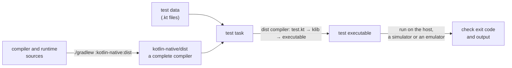

# Targets, toolchains, building and tests

Practical orientation: what a target is, how to build the compiler, and how its tests work. This page mostly points
elsewhere. The full reference for building, testing and debugging is [HACKING.md](../../kotlin-native/HACKING.md).



## Targets

A **target** is the platform a binary is built for: operating system plus CPU, such as `linux_x64`, `macos_arm64`,
`ios_arm64`, `ios_simulator_arm64`, `mingw_x64`, `android_arm64`. In code it is a `KonanTarget`. The **host** is the machine
the compiler runs on. They differ when cross-compiling: `konanc -target linux_arm64` on a `linux_x64` host.

| Host | Can build for |
|---|---|
| `linux_x64`, `mingw_x64` | Linux, Windows (MinGW) and Android targets |
| `macos_arm64` | all of the above, plus macOS, iOS, tvOS and watchOS |

A klib made from ordinary Kotlin code is the same for every target. Everything in the second stage is per target: the
runtime, the caches, the platform libraries, the LLVM settings.

## Toolchains

To turn LLVM IR into a binary the compiler needs, for each target: LLVM itself, a **sysroot** (the target's system headers
and libraries) and a linker. Which ones, and with which flags, is written in one file,
[konan.properties](../../kotlin-native/konan/konan.properties), as `key.<target> = value` lines:

```properties
llvmHome.linux_x64 = $llvm.linux_x64.dev
targetTriple.linux_x64 = x86_64-unknown-linux-gnu
targetSysRoot.linux_x64 = $gccToolchain.linux_x64/x86_64-unknown-linux-gnu/sysroot
clangOptFlags.linux_x64 = -O3
linkerKonanFlags.linux_x64 = -Bstatic -lstdc++ -Bdynamic -ldl -lm -lpthread ...
```

These are not expected to be installed on the machine. On first use the compiler downloads them into
`~/.konan/dependencies/` (for a Linux host: an LLVM build, a GCC toolchain with an old glibc as the sysroot, `lldb`,
`libffi`). The exception is Apple: the SDKs and the linker come from the locally installed Xcode, so Apple targets need a
Mac with Xcode.

## Building

1. Put `kotlin.native.enabled=true` into `local.properties` in the repository root. Without it the `:kotlin-native:*` Gradle
   projects do not exist.
2. `./gradlew :kotlin-native:dist` builds a **distribution** for the host into `kotlin-native/dist`: the same layout a user
   downloads.

```
dist/bin/                       konanc, cinterop, klib and other launch scripts
dist/konan/lib/                 the compiler itself (kotlin-native-compiler-embeddable.jar)
dist/konan/targets/<target>/    the runtime as LLVM bitcode: runtime.bc, one .bc per GC, allocator, ...
dist/konan/konan.properties     the toolchain settings from above
dist/klib/common/stdlib         the standard library klib
dist/klib/cache/                precompiled stdlib (→ caches.md)
dist/klib/platform/<target>/    platform libraries; only after :kotlin-native:distPlatformLibs (→ cinterop.md)
```

Where each part comes from in the repository: [code-map.md](code-map.md). A distribution for another target is built by
`:kotlin-native:<target>CrossDist`.

## Tests

| Kind | Test data or sources | What it checks |
|---|---|---|
| Box tests, shared with JVM, JS and Wasm | `compiler/testData/codegen/box` | language features behave correctly |
| Native-specific tests | `native/native.tests/testData` | interop, export, GC, caches, klibs, the debugger, ... |
| Standard library tests | the stdlib's own tests | the stdlib on Native |
| Runtime unit tests | `*Test.cpp` next to the C++ sources | the runtime alone, with Google Test, no compiler |

A **box test** is a Kotlin file with a function `box()` that returns `"OK"` when everything is right. This one is
`compiler/testData/codegen/box/arrays/forEachIntArray.kt`, complete:

```kotlin
fun box(): String {
    for (x in IntArray(5)) {
        if (x != 0) return "Fail $x"
    }
    return "OK"
}
```

The test infrastructure takes the compiler **from the distribution** (not from the IDE's classpath), compiles the file to a
klib and then to an executable, runs it and checks the result. Many box tests are compiled into one executable to save
time. Comments at the top of a file (**directives**) steer this, for example `// IGNORE_BACKEND: NATIVE` for a test that is
expected to fail on Native. JUnit classes are generated from the test data files into `build/tests-gen/` when a test task runs.

**FileCheck tests** look at the generated LLVM IR instead of the program's behaviour. The file names a compiler phase with
`// FILECHECK_STAGE:` and has `// CHECK:` comments with patterns; LLVM's `FileCheck` tool matches them against the IR after
that phase. Examples are in `native/native.tests/testData/codegen/fileCheck`.

### Test modes

The same tests can run under different compiler configurations. A bug often shows in only one of them.

| Property | Values | Meaning |
|---|---|---|
| `-Pkn.optimizationMode=` | `DEBUG` (default), `OPT`, `NO` | `OPT` runs the whole-program optimizations |
| `-Pkn.cacheMode=` | `NO`, `STATIC_ONLY_DIST`, `STATIC_EVERYWHERE`, ... | which klibs go through [caches](caches.md) |
| `-Pkn.gcType=` | `CMS` (default), `PMCS`, `STWMS`, `NOOP` | which [garbage collector](gc-and-allocator.md) is linked in |
| `-Pkn.target=` | a target name | cross-compile and run on a simulator or emulator |

### Commands you will use

```bash
# Native-specific tests from native/native.tests/testData/codegen
./gradlew :native:native.tests:test --tests "org.jetbrains.kotlin.konan.test.blackbox.FirNativeCodegenLocalTestGenerated*"
# the shared box tests from compiler/testData/codegen/box
./gradlew :native:native.tests:codegen-box:test \
    --tests "org.jetbrains.kotlin.konan.test.blackbox.FirNativeCodegenBoxTestGenerated\$Box\$*"
# the same, in another mode
./gradlew :native:native.tests:test --tests "..." -Pkn.optimizationMode=OPT -Pkn.gcType=CMS -Pkn.cacheMode=NO
# one group of tests: stdlibTest, cinteropTest, gcTest, cachesTest, klibTest, debuggerTest, ...
./gradlew :native:native.tests:stdlibTest
# runtime C++ unit tests
./gradlew :kotlin-native:runtime:hostRuntimeTests -Pgtest_filter='*GC*'
```

## Things to know

- **A test run rebuilds the distribution** when the compiler, the runtime or the stdlib changed, so the first run after an
  edit takes minutes. `-Pkn.nativeHome=<existing dist>` skips that, for example to run tests against a compiler you did not
  touch.
- **The repository-wide `./gradlew generateTests` does not generate the Native test classes.** Running the test task does.
- **Apple-only tests** (Objective-C export, Swift export, simulators) need a macOS host with Xcode.
- **`IGNORE` means "expected to fail"**: the test still runs, and fails if it unexpectedly passes. `// DISABLE_NATIVE` means
  it is not run at all. Both can be limited to one mode: `// IGNORE_NATIVE: optimizationMode=OPT`.
- **The dist has caches only for some flavors.** Running the compiler by hand with unusual options plus caching flags makes
  it build a stdlib cache first, inside the dist.

## Where the code is

- [HACKING.md](../../kotlin-native/HACKING.md): all test properties, tags and directives; debugging the compiler; LLVM tips
- [native/native.tests/README.md](../../native/native.tests/README.md): the layout of the test project
- [konan.properties](../../kotlin-native/konan/konan.properties) and
  [KonanTarget.kt](../../native/utils/src/org/jetbrains/kotlin/konan/target/KonanTarget.kt): targets and their toolchains
- [native/native.tests/testFixtures/](../../native/native.tests/testFixtures/org/jetbrains/kotlin/konan/test/blackbox): the test
  infrastructure: grouping, compilation, running
- [kotlin-native/runtime/src/](../../kotlin-native/runtime/src): the runtime and its `*Test.cpp` files
