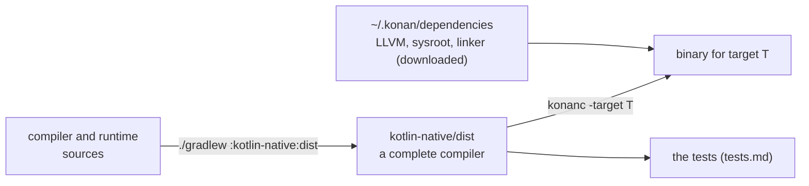

# Targets, toolchains and building

Practical orientation: what a target is, what the compiler needs to produce a binary for it, and how to build the compiler
itself. The full reference for building, testing and debugging is [HACKING.md](../../../kotlin-native/HACKING.md).



## Targets

A **target** is the platform a binary is built for: operating system plus CPU, such as `linux_x64`, `macos_arm64`,
`ios_arm64`, `ios_simulator_arm64`, `mingw_x64`, `android_arm64`. In code it is a `KonanTarget`. The **host** is the machine
the compiler runs on. They differ when cross-compiling: `konanc -target linux_arm64` on a `linux_x64` host.

| Host | Can build for |
|---|---|
| `linux_x64`, `mingw_x64` | Linux, Windows (MinGW) and Android targets |
| `macos_arm64` | all of the above, plus macOS, iOS, tvOS and watchOS |

A klib made from ordinary Kotlin code is the same for every target. Everything in the second stage is per target: the
runtime, the caches, the platform libraries, the LLVM settings.

## Toolchains

To turn LLVM IR into a binary the compiler needs, for each target: LLVM itself, a **sysroot** (the target's system headers
and libraries) and a linker. Which ones, and with which flags, is written in one file,
[konan.properties](../../../kotlin-native/konan/konan.properties), as `key.<target> = value` lines:

```properties
llvmHome.linux_x64 = $llvm.linux_x64.dev
targetTriple.linux_x64 = x86_64-unknown-linux-gnu
targetSysRoot.linux_x64 = $gccToolchain.linux_x64/x86_64-unknown-linux-gnu/sysroot
clangOptFlags.linux_x64 = -O3
linkerKonanFlags.linux_x64 = -Bstatic -lstdc++ -Bdynamic -ldl -lm -lpthread ...
```

These are not expected to be installed on the machine. On first use the compiler downloads them into
`~/.konan/dependencies/` (for a Linux host: an LLVM build, a GCC toolchain with an old glibc as the sysroot, `lldb`,
`libffi`). The exception is Apple: the SDKs and the linker come from the locally installed Xcode, so Apple targets need a
Mac with Xcode.

## Building

1. Put `kotlin.native.enabled=true` into `local.properties` in the repository root. Without it the `:kotlin-native:*` Gradle
   projects do not exist.
2. `./gradlew :kotlin-native:dist` builds a **distribution** for the host into `kotlin-native/dist`: the same layout a user
   downloads.

```
dist/bin/                       konanc, cinterop, klib and other launch scripts
dist/konan/lib/                 the compiler itself (kotlin-native-compiler-embeddable.jar)
dist/konan/targets/<target>/    the runtime as LLVM bitcode: runtime.bc, one .bc per GC, allocator, ...
dist/konan/konan.properties     the toolchain settings from above
dist/klib/common/stdlib         the standard library klib
dist/klib/cache/                precompiled stdlib (→ caches.md)
dist/klib/platform/<target>/    platform libraries; only after :kotlin-native:distPlatformLibs (→ cinterop.md)
```

Where each part comes from in the repository: [code-map.md](../code-map.md). A distribution for another target is built by
`:kotlin-native:<target>CrossDist`.

## Tests

How the compiler is tested has its own page: [tests.md](tests.md). It covers the kinds of tests, what happens to one test
from the test data file to the checked result, test modes, and how to add a test and investigate a failing one. The
one thing to remember here: tests run the compiler from `kotlin-native/dist`, so they need the build described above.

## Things to know

- **Without `kotlin.native.enabled=true` nothing Native exists in Gradle**: the `:kotlin-native:*` projects are missing and
  the Native test tasks fail.
- **Apple targets need a Mac with Xcode**, both to produce binaries for them and to run their tests.
- **The dist has caches only for some flavors.** Running the compiler by hand with unusual options plus caching flags makes
  it build a stdlib cache first, inside the dist.

## Where the code is

- [HACKING.md](../../../kotlin-native/HACKING.md): building, debugging the compiler, LLVM tips
- [konan.properties](../../../kotlin-native/konan/konan.properties) and
  [KonanTarget.kt](../../../native/utils/src/org/jetbrains/kotlin/konan/target/KonanTarget.kt): targets and their toolchains
- [kotlin-native/build.gradle](../../../kotlin-native/build.gradle): the `dist` tasks that assemble the distribution
