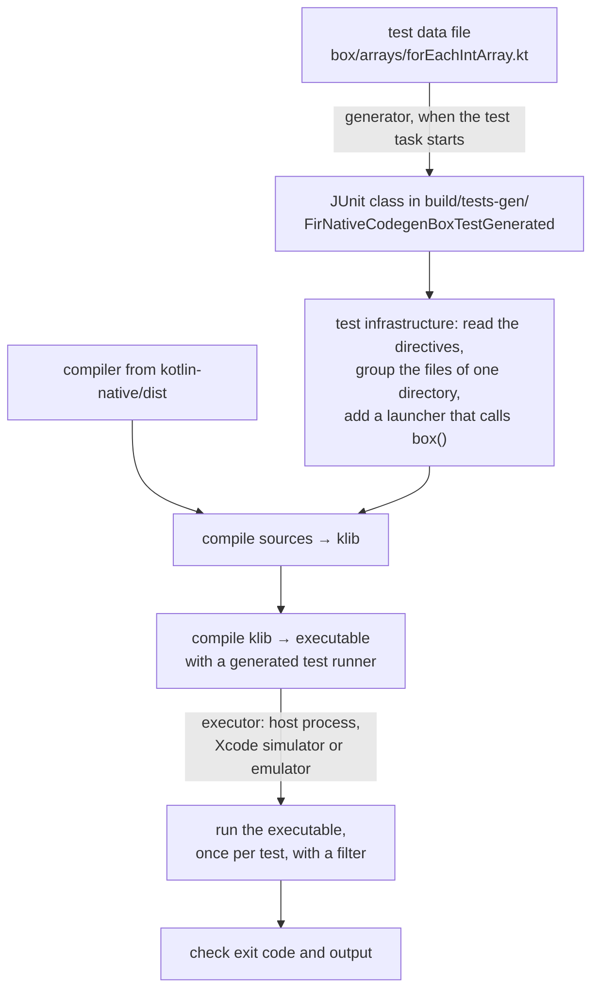

[Kotlin/Native guide](../README.md) › [build-and-tests](README.md) › tests

# How Kotlin/Native is tested

*Skip this page if you have added a Native box test, run it in another test mode and found the compiler command in its log.*

Almost all tests of the compiler are **black-box tests**: a Kotlin file is compiled by the real compiler into a real binary,
the binary is run, and its output and exit code are checked. This catches bugs in any step from the frontend to the linker
and the runtime, but a failing test only says "the program misbehaved"; finding the step is up to you
([debugging.md](../reference/debugging.md)). The full reference is [HACKING.md](../../../kotlin-native/HACKING.md#testing).

## The life of one box test

A **box test** is a Kotlin file with a function `box()` that returns `"OK"` when everything is right. This one is
`compiler/testData/codegen/box/arrays/forEachIntArray.kt`, complete. The JVM, JS and Wasm backends run the same file.

```kotlin
fun box(): String {
    for (x in IntArray(5)) {
        if (x != 0) return "Fail $x"
    }
    return "OK"
}
```



Many files end up in one executable because linking a binary per file would be too slow. A test that cannot share one,
for example a FileCheck test, gets its own executable (it is **standalone**).

## The kinds of tests

Test data paths without a prefix are under `native/native.tests/testData/`. The Gradle task for each kind is in
[cheat-sheet.md](../reference/cheat-sheet.md).

| Kind | Test data |
|---|---|
| Box tests shared with other backends | `compiler/testData/codegen/box`, `boxInline` |
| Native-only box tests; FileCheck tests (below) | `codegen/`; `codegen/fileCheck/` |
| Programs with their own `main`, checked by output | `standalone/` |
| Garbage collector; standard library | `gc/`; the stdlib's own tests in `libraries/stdlib` |
| Klib contents; partial linkage | `klib/`; `compiler/testData/klib/partial-linkage` |
| Klib compatibility: box tests with one stage done by an old released compiler | the box tests above; project `klib-compatibility/` |
| First stage only: IR and klib dumps, diagnostics, klib tools | `compiler/testData/ir`, `klib`, ...; project `klib-ir-inliner/` |
| Caches and incremental compilation | `caches/` |
| cinterop; Objective-C and C export | `CInterop/`, `interop/`; `ObjCExport/`, `CExport/` |
| Swift export | `native/swift/*/testData` |
| Debugger: an [`lldb`](https://lldb.llvm.org/) session against a binary | `lldb/` |
| Runtime unit tests: C++, [Google Test](https://google.github.io/googletest/), no compiler | `*Test.cpp` next to the runtime sources |
| Compiler unit tests, no dist needed; one is `NativeLoweringPrerequisitesTest` (order of lowerings) | `kotlin-native/backend.native/compiler/ir/backend.native/test` |

## FileCheck tests

Some properties cannot be seen from outside: "this object is allocated on the stack", "this call was devirtualized". A
**FileCheck test** checks the generated LLVM IR instead: LLVM's [`FileCheck`][filecheck] tool matches the `// CHECK` comments
against the IR saved after the named phase, in order. From `codegen/fileCheck/escape_analysis.kt`:

```kotlin
// FILECHECK_STAGE: CStubs                                   ← look at the IR after this compiler phase
class A(val x: Int)
// CHECK-LABEL: define ptr @"kfun:#box(){}kotlin.String"     ← find this function first
fun box(): String {
    // CHECK-DEBUG: call ptr @AllocInstance                  ← debug build: A is allocated in the heap
    // CHECK-OPT: alloca %"kclassbody:A#internal"            ← -opt: escape analysis put it on the stack
    val a = A(5); println(a.x)
    return "OK"
}
```

## Directives

Comments at the top of a test file steer the infrastructure. The ones you will meet:
```kotlin
// TARGET_BACKEND: NATIVE                     run only on Native (shared directive)
// IGNORE_BACKEND: NATIVE                     expected to fail on Native in every mode; fails if it passes (shared)
// IGNORE_NATIVE: optimizationMode=OPT && cacheMode=STATIC_ONLY_DIST     the same, in this mode only
// DISABLE_NATIVE: targetFamily=MINGW         do not compile or run at all for these targets
```

One file can hold several source files and modules; each module becomes its own klib. This is the complete
`compiler/testData/codegen/box/compileKotlinAgainstKotlin/nestedClassAsBound.kt` (class body joined into one line):
```kotlin
// MODULE: lib
// FILE: Q.kt
class Q<T : Q.S> { open class S { val ok = "OK" } }
// MODULE: main(lib)                          main depends on lib
// FILE: box.kt
fun box() = Q.S().ok
```

## Test modes

The compiler has many configurations, and a bug often shows in only one of them. So the same tests can run in different
**modes**, chosen with [Gradle properties][gradleprops]: the optimization mode (debug by default, or `-opt` with the
[whole-program optimizations](../compiler/optimizations/README.md)), which klibs go through [caches](../compiler/caches.md),
which [garbage collector](../runtime/gc-and-allocator.md) is linked in, the target, and whether every test gets its own
executable. The properties and their values are in [cheat-sheet.md](../reference/cheat-sheet.md).

## Adding and running a test

1. Put a `.kt` file into the right test data directory. There is nothing to register.
2. Run the test task. It first generates the [JUnit][junit] classes into `build/tests-gen/` (they are not checked in, and the
   repository-wide `./gradlew generateTests` does not make them). The class nests one level per directory and the method
   is `test` plus the file name:

```bash
# native/native.tests/testData/codegen/fileCheck/smoke0.kt
./gradlew :native:native.tests:test \
    --tests "org.jetbrains.kotlin.konan.test.blackbox.FirNativeCodegenLocalTestGenerated\$FileCheck.testSmoke0"
```

## When a test fails

- **Find the log.** Every compiled artifact has a `<artifact>.log` next to it, under `<project>/build/t/bb.out/` for box
  tests. It holds the test data files, the exact command line after `COMPILER ARGUMENTS:`, and the compiler's output.
- **Reproduce by hand.** Copy that command line into a shell. It starts with `<dist>/bin/kotlinc-native`, which is the
  same compiler as `konanc`. Then add dump flags from the [cheat sheet](../reference/cheat-sheet.md).
- **Dozens of sources in the command?** The test shares an executable with its neighbours. Run it in the standalone mode.
- **"Test did not fail as expected"**: the test has an `IGNORE` directive but now passes. Remove or narrow the directive.

## Things to know

- **Tests use the compiler from `kotlin-native/dist`**, not the classes in the IDE. A test run rebuilds the dist when the
  compiler, the runtime or the stdlib changed: minutes per edit. A test mode can point at an existing dist instead.
- **Grouped tests are changed before compilation**: their declarations are moved into a package made from the file's path
  so that they do not clash. A test can therefore behave differently alone and in a group.
- **FileCheck tests are skipped in cache modes that cache the test's own klibs.**
- **Tests do not run the compiler the way you do by hand.** They pass `-Xverify-ir=error -Xphases-to-validate-after=all`,
  so malformed IR fails a test, while plain `konanc` validates nothing. And unless a cache mode is given, debug tests use
  the dist's stdlib cache (`STATIC_ONLY_DIST`) and `-opt` tests use no cache. Reproduce with the logged command line.

## Where the code is

- [native/native.tests/README.md](../../../native/native.tests/README.md): the layout of the test project
- [testFixtures/.../blackbox/support/](../../../native/native.tests/testFixtures/org/jetbrains/kotlin/konan/test/blackbox/support): the infrastructure: `group/`, `compilation/`, `runner/`
- [TestDirectives.kt](../../../native/native.tests/testFixtures/org/jetbrains/kotlin/konan/test/blackbox/support/TestDirectives.kt): the Native directives, with descriptions

[filecheck]: https://llvm.org/docs/CommandGuide/FileCheck.html
[gradleprops]: https://docs.gradle.org/current/userguide/build_environment.html#sec:project_properties
[junit]: https://junit.org/
