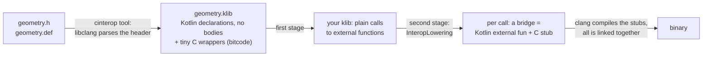

# Calling C and Objective-C from Kotlin (cinterop)

Kotlin/Native programs call C and Objective-C libraries directly: `printf`, `NSString`, your own `.h` files. The compiler
itself never reads a C header. A separate tool, **cinterop**, reads the header once and writes a klib of Kotlin declarations.
From then on the library looks like any other Kotlin dependency, and the compiler generates the glue for each call.



## One example, end to end

A header, and a **`.def` file** (`geometry.def`) with two lines, `headers = geometry.h` and `package = geometry`, that tells
the tool what to read and which Kotlin package to produce:

```c
struct Point { int x; int y; };
int manhattan(const struct Point* p);
static inline int twice(int v) { return 2 * v; }        // exists only in the header: there is no symbol to link to
```

`kotlin-native/dist/bin/cinterop -def geometry.def -compiler-option -I. -o geometry` writes `geometry.klib`. It has metadata
(`default/linkdata/`) but no `default/ir/`, and one extra file, `default/targets/linux_x64/native/cstubs.bc`: LLVM bitcode of
small C wrappers, compiled by clang against the real header. The declarations (`klib dump-metadata geometry.klib`, shortened)
carry annotations that record how each one maps back to C:

```kotlin
class Point(rawPtr: NativePtr) : CStructVar {
    var x: Int   @CStruct.MemberAt(offset = 0L) external get; external set     // a field is "an Int at offset 0"
    var y: Int   @CStruct.MemberAt(offset = 4L) external get; external set
}
@CCall.Direct(name = "manhattan")                       // the C symbol, for a direct call
@CCall(id = "knifunptr_geometry_manhattan_0")           // a function pointer defined in cstubs.bc, for an indirect call
external fun manhattan(p: CValuesRef<Point>?): Int
@CCall(id = "knifunptr_geometry_twice_0")               // inline function: only the indirect way exists
external fun twice(v: Int): Int
```

Kotlin code that uses it (`konanc main.kt -l geometry.klib -linker-options geometry.o`):
```kotlin
fun distance(px: Int, py: Int): Int = memScoped {
    val p = alloc<Point>()          // native memory for one struct, freed when the block ends
    p.x = px
    p.y = py
    manhattan(p.ptr)
}
```

`InteropLowering` rewrites the three interop operations (real IR, shortened):

```kotlin
nativeMemUtils.putInt(mem = interpretNullablePointed(p.rawPtr + 0L), value = px)   // p.x = px: a raw memory write
nativeMemUtils.putInt(mem = interpretNullablePointed(p.rawPtr + 4L), value = py)   // the offset came from @MemberAt
@KotlinToCBridge(language = "C", impl = "<the C text below>", library = "geometry")
local external fun knbridge1(p0: CPointer<*>?): Int                                // a bridge made for this call site
knbridge1(p0 = p.ptr)                                                              // was: manhattan(p.ptr)
```
```c
extern const int (*target2)(void *) __asm("knifunptr_geometry_manhattan_0");       // the generated C stub
int knbridge1(void *p1) { return target2(p1); }
```

The pointer `knifunptr_geometry_manhattan_0` is defined in the klib's `cstubs.bc` and points to a wrapper that calls the
real function. So by default a call goes: Kotlin → C stub → wrapper → `manhattan`. The stubs are compiled by the clang that
ships with the compiler, into bitcode that is merged into the program. The call site in LLVM IR:

```llvm
call void @Kotlin_mm_switchThreadStateNative_debug()            ; tell the GC: this thread is now running foreign code
%46 = invoke i32 @"..._knbridge1"(ptr %45) to label %ok unwind label %filteringExceptionHandler      ; the C stub
call void @Kotlin_mm_switchThreadStateRunnable_debug()          ; back in Kotlin
```

Why the indirection: the wrapper is compiled by clang against the real header, so inline functions and C calling conventions
are handled by a C compiler, not re-implemented in Kotlin/Native. When a plain symbol exists (`@CCall.Direct`), the stub can
call it directly instead; `-Xbinary=cCallMode=` selects the mode.

## How C types map

| C | Kotlin |
|---|---|
| `int`, `long long`, `double`, `unsigned char` | `Int`, `Long`, `Double`, `UByte` |
| `struct S` | a class `S : CStructVar`; an instance is a typed view of native memory, not a Kotlin heap object |
| `T*` | `CPointer<T>`; as a parameter `CValuesRef<T>?`, which also accepts Kotlin-side values copied in for the call |
| `char*` | `CPointer<ByteVar>`; `"text".cstr` and `ptr.toKString()` convert |
| function pointer | `CPointer<CFunction<(Int) -> Int>>`; `staticCFunction { ... }` makes one from a non-capturing lambda |

This API is the package `kotlinx.cinterop`, part of the stdlib klib. Native memory is not garbage collected:
`nativeHeap.alloc` needs an explicit `free`, while `memScoped { }` frees everything allocated inside it when the block
ends. A `CPointer` is just an address and keeps nothing alive.

## Objective-C

With `language = Objective-C` in the `.def`, the same tool also maps Objective-C (Apple targets only):

- An Objective-C class or protocol becomes a Kotlin class or interface; methods become member functions.
- Calling a method sends a message: the bridge calls `objc_msgSend` with the selector, as clang would.
- Objective-C objects are reference counted. The Kotlin object standing for one holds a retain until the GC collects it.
- A Kotlin class can subclass an Objective-C class (`class MyDelegate : NSObject(), UITableViewDelegateProtocol`). The
  runtime creates a real Objective-C class for it at run time, so UIKit can call into Kotlin.

## Platform libraries

**Platform libraries** are cinterop klibs for the system APIs of each target, built from `.def` files in this repository
and shipped with the distribution in `klib/platform/<target>/`: `platform.posix` everywhere, `platform.Foundation`,
`platform.UIKit` and many more on Apple targets, `platform.linux` and `platform.zlib` on Linux. Every compilation for a
target sees them without any flag. `./gradlew :kotlin-native:dist` does not build them (`import platform.posix.*` fails);
`./gradlew :kotlin-native:distPlatformLibs` does.

## The commonizer

A cinterop klib is for one target, so `platform.posix` for `linux_x64` and for `macos_arm64` are two different libraries.
Code in a source set shared by both targets needs one API to compile against. The **commonizer** (run by the Gradle plugin,
not by the compiler) takes the per-target klibs and produces a metadata-only klib with what they have in common.
Declarations missing on any target are dropped. Final binaries are still compiled against the real per-target klibs.

```kotlin
// target a                          // target b                          // commonized (a, b)
fun x(): Int                         fun x(): Int                         expect fun x(): Int
typealias X = Int                    typealias X = Long                   @UnsafeNumber(["a: kotlin.Int", "b: kotlin.Long"])
fun onlyHere()                                                            typealias X = Int
```

## Things to know

- **The compiler never sees a header, and a cinterop klib has no IR.** The second stage builds body-less declarations from
  the metadata; all behaviour comes from the annotations (`@CCall`, `@CStruct.MemberAt`, `@ObjCMethod`). If a declaration is
  wrong or missing, look at the tool and the klib it wrote (`klib dump-metadata`), not at the compiler.
- **A cinterop klib is tied to its targets**, unlike an ordinary klib: struct offsets and type sizes are baked in.
- **Every call switches the thread state** to "native" and back, so the GC does not wait for a thread that sits in C code.
  → [runtime.md](runtime.md)
- **A foreign exception that reaches Kotlin terminates the program** (the `filteringExceptionHandler` above), unless the
  library asks for Objective-C exceptions to be wrapped. → [exceptions.md](exceptions.md)

## Where the code is

- [kotlin-native/Interop/](../../kotlin-native/Interop/README.md): the tool. `Indexer` wraps libclang, `StubGenerator`
  produces the klib, `Runtime` is `kotlinx.cinterop`
- [InteropLowering.kt](../../kotlin-native/backend.native/compiler/ir/backend.native/src/org/jetbrains/kotlin/backend/konan/lower/InteropLowering.kt):
  rewrites calls and struct access;
  [CBridgeGen.kt](../../kotlin-native/backend.native/compiler/ir/backend.native/src/org/jetbrains/kotlin/backend/konan/cgen/CBridgeGen.kt)
  knows how each Kotlin type is passed to C
- [ObjCInterop.mm](../../kotlin-native/runtime/src/main/cpp/ObjCInterop.mm): runtime support for Kotlin subclasses of
  Objective-C classes
- [platformLibs/src/platform/](../../kotlin-native/platformLibs/src/platform): the `.def` files of the platform libraries
- [native/commonizer/](../../native/commonizer/README.md): the commonizer
