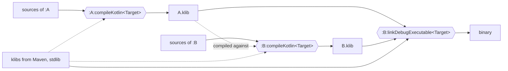
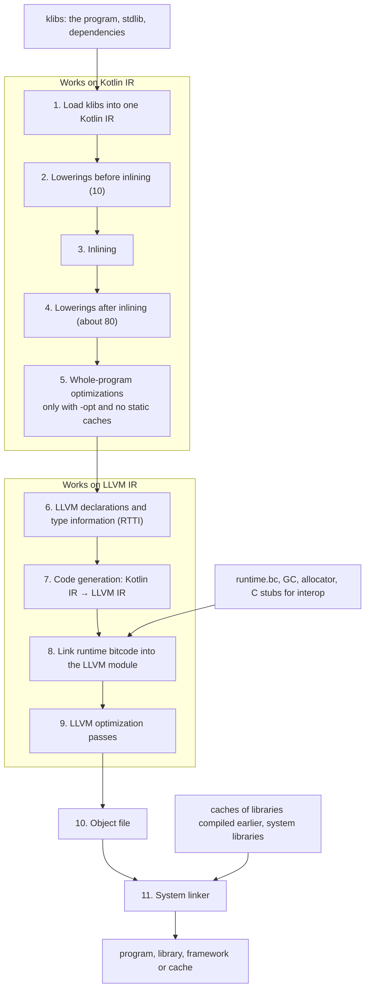

[Kotlin/Native guide](../README.md) › compiler

# The pipeline: from klibs to a binary

*Skip this page if you know the two stages, what Gradle's "compile" and "link" tasks run, and the backend's steps in order.*

Kotlin/Native compiles in two stages. The **first stage** turns sources into a klib and is mostly shared with the other
Kotlin backends. The **second stage** turns a set of klibs into a binary. It is what people mean by "the Native backend".
This page shows the two stages from the outside and then lists the steps of the second one in order. The same steps on a
real program are in the [tour](../tour.md).

## The outside view

[Building a binary][binaries] in Gradle project `:B`, which depends on project `:A`. Each hexagon is one invocation of the
compiler:

- **"compile" tasks run the first stage**: sources → klib. Klibs are what gets published, and what dependencies from Maven
  are. → [klibs-and-linking.md](klibs-and-linking.md)
- **"link" tasks run the second stage**: all klibs → binary. Despite the name, this is where all code generation happens.
  In this guide, "linking" is either IR linking (connecting klibs) or the system linker, never the Gradle task.
- **`konanc` can run both stages in one command**: `konanc main.kt -o main` compiles the sources into a temporary klib and
  runs the second stage on it. Gradle never does that.

**The closed world.** A binary always contains everything it needs: its own code, all dependencies, the stdlib and the
runtime. The second stage relies on seeing all of it at once, so two Kotlin/Native binaries never share Kotlin code through,
say, a common dynamic library. If frameworks `Feature1` and `Feature2` both depend on project `:core`, each contains its own
copy of `:core` and its own runtime, and a `Data` object from one is a different type for the other. The fix is one
**umbrella framework** that includes all the Kotlin projects the application needs.

**Why "link" is slow.** The second stage compiles the whole world every time. [Caches](caches.md) reuse machine code from
earlier runs: each dependency klib is compiled once into a static library, and (experimentally) each source file of the
project too. Gradle uses them for debug binaries only: release binaries (`-opt`) get whole-program optimizations, which
need the IR of every library and are skipped as soon as one comes from a static cache. So debug and release builds
exercise different compiler code.

**Other languages.** The `cinterop` tool turns C or Objective-C headers into a klib that the compiler accepts as a
dependency like any other ([cinterop.md](../interop/cinterop.md)). In the other direction the compiler produces a framework
or a C library with a generated header ([export.md](../interop/export.md)).

## The steps of the second stage

1. **Loading klibs.** The IR of every klib is read and references between klibs are connected, so the rest of the pipeline
   sees one program. → [klibs-and-linking.md](klibs-and-linking.md)
2. **Lowerings before inlining.** A short list that prepares functions for being inlined. It ends by generating accessors
   for private declarations that an inline function uses, because the inlined copy will live in another file.
3. **Inlining.** Bodies of `inline` functions are pasted into their call sites, across files and libraries. With the
   current default language version this already happened in the first stage, so there is work left here only for klibs
   built with an older one.
4. **Lowerings after inlining.** The long list. Each one rewrites a language feature (enums, lambdas, coroutines, string
   templates, default arguments, ...) into simpler IR. → [lowerings/](lowerings/README.md)
5. **Whole-program optimizations.** Devirtualization, dead code elimination and escape analysis, on a data-flow graph of
   the whole program. → [optimizations/](optimizations/README.md)
6. **LLVM declarations and RTTI.** Every function, class and global gets its LLVM declaration first, so that code can
   refer to things that are generated later. Then the constants that describe classes at run time are emitted
   ([**RTTI**][rtti], run-time type information). → [object-model.md](../runtime/object-model.md)
7. **Code generation.** Each function body is translated to LLVM IR. → [codegen.md](codegen.md)
8. **Steps 8 to 11** merge the runtime's bitcode and the C stubs generated for interop calls into the module, run LLVM's
   [passes][passes], write an object file and call the system linker, which also adds the caches of libraries.
   → [codegen.md](codegen.md#after-code-generation)

## Fragments and output kinds

A **fragment** is the unit that becomes one LLVM module, and so one object file. Normally there is one fragment: the whole
program. When the compiler builds per-file [caches](caches.md) for a library, each source file is its own fragment. Steps
1 to 4 run once over all fragments; steps 5 to 11 run per fragment.

The **output kind** (`-produce`, or `-p`) does not select a different pipeline. All kinds go through the steps above and
differ only at the edges:

| Output kind | What you get, and what is different |
|---|---|
| `program` | `name.kexe` (or `.exe`). An entry point that calls `main` is added. With `-generate-test-runner` it runs all `@Test` functions instead; Gradle test tasks use that |
| `static`, `dynamic` | `libname.a`, or `libname.so` / `.dylib` / `.dll`, plus a generated C header and C adapter functions → [export.md](../interop/export.md) |
| `framework` | `Name.framework` with a generated Objective-C header; usable from Swift → [export.md](../interop/export.md) |
| `static_cache` and other cache kinds | Only one library is compiled, not the whole program → [caches.md](caches.md) |
| `library` | Not a binary: a klib, the output of the first stage |

## The first stage in three lines

Sources go through the K2 frontend (FIR), are translated to Kotlin IR, get a few lowerings that must happen before
serialization, and are written into a klib together with metadata. No LLVM is involved, so this stage can run where
native libraries are not available. The code is in `compiler/cli/cli-native-klib`, class `NativeKlibCliPipeline`.

## Things to know

- **Lowerings run file by file**, and a lowering normally changes only the file it runs on. Inlining is the exception: it
  reads bodies from other files. So all files are brought to the same point before inlining starts.
- **Phase names are class names.** Each lowering is a phase named after its class, for example `EnumClassLowering`. The
  other steps have names such as `Devirtualization`, `DCEPhase`, `EscapeAnalysis`, `Codegen`, `Linker`. The flags that dump
  IR before or after a phase, or switch a phase off, take these names. → [cheat-sheet.md](../reference/cheat-sheet.md)

## Where the code is

- [TopLevelPhases.kt](../../../kotlin-native/backend.native/compiler/ir/backend.native/src/org/jetbrains/kotlin/backend/konan/driver/phases/TopLevelPhases.kt):
  the pipeline itself. `runBackend` covers steps 2 to 11; `runCodegen` is the exact order of steps 5 to 7.
- [NativeLoweringPhases.kt](../../../kotlin-native/backend.native/compiler/ir/backend.native/src/org/jetbrains/kotlin/backend/konan/driver/phases/NativeLoweringPhases.kt):
  the two lists of lowerings, in order.
- [NativeCompilerDriver.kt](../../../kotlin-native/backend.native/compiler/ir/backend.native/src/org/jetbrains/kotlin/backend/konan/driver/NativeCompilerDriver.kt):
  what each output kind adds around the common pipeline.
- [K2Native.kt](../../../native/cli-native/src/org/jetbrains/kotlin/cli/bc/K2Native.kt): the command-line entry point; decides
  which stage to run.
- [NativeKlibCliPipeline.kt](../../../compiler/cli/cli-native-klib/src/main/kotlin/org/jetbrains/kotlin/native/pipeline/NativeKlibCliPipeline.kt):
  the first stage.

## Go deeper

| Page | What it explains |
|---|---|
| [klibs-and-linking.md](klibs-and-linking.md) | What a klib holds and how several klibs become one program (step 1) |
| [lowerings/](lowerings/README.md) | How language features are rewritten into simpler IR (steps 2 to 4) |
| [optimizations/](optimizations/README.md) | Whole-program optimizations (step 5) |
| [codegen.md](codegen.md) | Kotlin IR to LLVM IR, and LLVM IR to a binary (the remaining steps) |
| [caches.md](caches.md) | How most of this work is skipped for libraries that did not change |

[binaries]: https://kotlinlang.org/docs/multiplatform/multiplatform-build-native-binaries.html
[rtti]: https://en.wikipedia.org/wiki/Run-time_type_information
[passes]: https://llvm.org/docs/Passes.html
