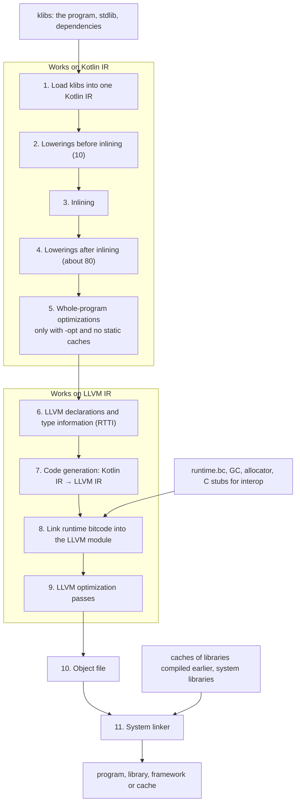

# The pipeline: from klibs to a binary

Kotlin/Native compiles in two stages. The **first stage** turns sources into a klib and is mostly shared with the other
Kotlin backends. The **second stage** turns a set of klibs into a binary. It is what people mean by "the Native backend",
and this page lists its steps in order. For the same steps shown on a real program, read the [tour](../tour.md) first.



## The steps

1. **Loading klibs.** The IR of every klib is read and references between klibs are connected, so the rest of the pipeline
   sees one program. → [klibs-and-linking.md](klibs-and-linking.md)
2. **Lowerings before inlining.** A short list that prepares functions for being inlined. It ends by generating accessors
   for private declarations that an inline function uses, because the inlined copy will live in another file.
3. **Inlining.** Bodies of `inline` functions are pasted into their call sites, across files and libraries. With the
   current default language version this already happened in the first stage, so there is work left here only for klibs
   built with an older one.
4. **Lowerings after inlining.** The long list. Each one rewrites a language feature (enums, lambdas, coroutines, string
   templates, default arguments, ...) into simpler IR. → [lowerings/](lowerings/README.md)
5. **Whole-program optimizations.** The compiler builds a data-flow graph of the whole program, then runs, in this order:
   devirtualization (replace virtual calls with direct ones), dead code elimination (drop what `main` cannot reach) and,
   just before code generation, escape analysis (find objects that can live on the stack). → [optimizations/](optimizations/README.md)
6. **LLVM declarations and RTTI.** Every function, class and global gets its LLVM declaration first, so that code can
   refer to things that are generated later. Then the constants that describe classes at run time are emitted (**RTTI**,
   run-time type information). → [object-model.md](../runtime/object-model.md)
7. **Code generation.** Each function body is translated to LLVM IR. → [codegen.md](codegen.md)
8. **Linking runtime bitcode.** The C++ runtime ships as LLVM bitcode. The files matching the chosen options (which GC,
   which allocator) are merged into the program's LLVM module, together with small C stubs generated for interop calls.
   → [runtime/](../runtime/README.md)
9. **LLVM passes.** LLVM optimizes the merged module, so runtime functions can be inlined into Kotlin code. Debug builds
   run very few passes. → [llvm-primer.md](../llvm-primer.md)
10. **Object file.** The module is written as bitcode, and the bundled Clang compiles it to an object file (`.o`).
11. **Linker.** The system linker combines the object file, caches of libraries and system libraries into the result.

## Fragments and output kinds

A **fragment** is the unit that becomes one LLVM module, and so one object file. Normally there is one fragment: the whole
program. When the compiler builds per-file [caches](caches.md) for a library, each source file is its own fragment. Steps
1 to 4 run once over all fragments; steps 5 to 11 run per fragment.

The **output kind** (`-produce`, or `-p`) does not select a different pipeline. All kinds go through the steps above and
differ only at the edges:

| Output kind | What is different |
|---|---|
| `program` | An entry point that calls `main` is added |
| `static`, `dynamic` | A C header and C adapter functions are generated next to the code → [export.md](../interop/export.md) |
| `framework` | An Objective-C header and the framework bundle are generated → [export.md](../interop/export.md) |
| `static_cache` and other cache kinds | Only one library is compiled, not the whole program → [caches.md](caches.md) |

`-p library` is not in the table: it produces a klib and that is the first stage.

## The first stage in three lines

Sources go through the K2 frontend (FIR), are translated to Kotlin IR, get a few lowerings that must happen before
serialization, and are written into a klib together with metadata. No LLVM is involved, so this stage can run where
native libraries are not available. The code is in `compiler/cli/cli-native-klib`, class `NativeKlibCliPipeline`.

## Things to know

- **One command can run both stages.** `konanc main.kt -o main` compiles the sources into a temporary klib and then runs
  the second stage on it. Gradle always runs the stages separately: `compileKotlin<Target>` and `link...<Target>`.
- **Whole-program optimizations need the whole program.** They are skipped when any library comes from a static cache,
  because the compiler then has no IR to change for that library. This is why Gradle uses caches for debug builds only.
- **Lowerings run file by file**, and a lowering normally changes only the file it runs on. Inlining is the exception: it
  reads bodies from other files. So all files are brought to the same point before inlining starts.
- **Phase names are class names.** Each lowering is a phase named after its class, for example `EnumClassLowering`. The
  other steps have names such as `Devirtualization`, `DCEPhase`, `EscapeAnalysis`, `Codegen`, `Linker`. The flags below
  take these names.
- **The exact order of steps 5 to 7** is one function, `runCodegen`. Read it when you need to know what runs before what.

## Looking inside

```bash
# Kotlin IR before or after a phase, one file per source file (the stdlib included). Never pass "all": it writes about 1 GB.
konanc main.kt -o main -Xphases-to-dump-after=EnumClassLowering -Xdump-directory=ir \
    -Dorg.jetbrains.kotlin.compiler.ir.dump.strategy=KotlinLike      # Kotlin-like text instead of a tree

# LLVM IR after a phase: ll/out.Codegen.ll (the directory must exist)
konanc main.kt -o main -Xsave-llvm-ir-after=Codegen -Xsave-llvm-ir-directory=ll

# Keep the intermediate files: tmp/out.bc (the final bitcode) and tmp/main.kexe.o
konanc main.kt -o main -Xtemporary-files-dir=tmp

# Skip a phase, to check whether it causes a problem
konanc main.kt -o main -opt -Xdisable-phases=EscapeAnalysis
```

## Where the code is

- [TopLevelPhases.kt](../../../kotlin-native/backend.native/compiler/ir/backend.native/src/org/jetbrains/kotlin/backend/konan/driver/phases/TopLevelPhases.kt):
  the pipeline itself. `runBackend` covers steps 2 to 11, `runCodegen` steps 5 to 7.
- [NativeLoweringPhases.kt](../../../kotlin-native/backend.native/compiler/ir/backend.native/src/org/jetbrains/kotlin/backend/konan/driver/phases/NativeLoweringPhases.kt):
  the two lists of lowerings, in order.
- [NativeCompilerDriver.kt](../../../kotlin-native/backend.native/compiler/ir/backend.native/src/org/jetbrains/kotlin/backend/konan/driver/NativeCompilerDriver.kt):
  what each output kind adds around the common pipeline.
- [K2Native.kt](../../../native/cli-native/src/org/jetbrains/kotlin/cli/bc/K2Native.kt): the command-line entry point; decides
  which stage to run.
- [NativeKlibCliPipeline.kt](../../../compiler/cli/cli-native-klib/src/main/kotlin/org/jetbrains/kotlin/native/pipeline/NativeKlibCliPipeline.kt):
  the first stage.

## In this directory

| Page | What it explains |
|---|---|
| [compilation-model.md](compilation-model.md) | The outside view: klibs, binaries, caches, interop, export |
| [klibs-and-linking.md](klibs-and-linking.md) | What a klib holds and how several klibs become one program (step 1) |
| [lowerings/](lowerings/README.md) | How language features are rewritten into simpler IR (steps 2 to 4) |
| [optimizations/](optimizations/README.md) | Whole-program optimizations (step 5) |
| [codegen.md](codegen.md) | Kotlin IR to LLVM IR, and LLVM IR to a binary (the remaining steps) |
| [caches.md](caches.md) | How most of this work is skipped for libraries that did not change |
