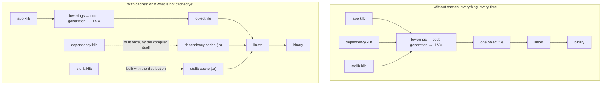

# Caches: precompiled libraries

The second stage compiles the whole program at once: your code, the stdlib and every dependency go through lowerings, code
generation and LLVM on every build, even when only one line of your code changed. A **cache** avoids this. It is a klib
compiled ahead of time to machine code (a static library plus some side information), which later builds reuse and only
link.

The effect on a three-line `main` that calls `listOf(1, 2, 3).map { it * 2 }` (measured with the compiler built from this
repository, `konanc -g`, without and with `-Xcache-directory=<dist>/klib/cache/linux_x64-gSTATIC-system`):

| | compile time | functions that go through code generation |
|---|---|---|
| no cache | 8.9 s | 5419 (ours plus the whole stdlib) |
| stdlib from its cache | 2.8 s | 5 (`main`, `Konan_start` and three initializers) |



## What a cache is

A cache is a directory named after the klib. This is a piece of the stdlib cache in the distribution:

```
klib/cache/linux_x64-gSTATIC-system/            the "flavor": target, -g, and every option that changes generated code
  stdlib-per-file-cache/
    kotlin.collections.1lhofm/                  one stdlib source file (per-file cache, see below)
      bin/libkotlin.collections.1lhofm.a        the machine code
      bin/bitcode_deps                          which other caches this code calls into: they must be linked too
      ir/class_fields                           field layout of the classes declared here
      ir/inline_bodies                          where to find the bodies of inline functions in the klib
      ir/eager_init, ir/trivial_getters, ...    a few more facts the compiler normally reads from the IR
      metadata.properties                       hash of the klib, compiler and runtime fingerprints
```

The `ir/` files exist because a consumer does not load the IR of a cached library: it only loads declaration headers. But it
still needs a few things that are normally computed from bodies, such as how big an object of a class is. Inline functions
are the exception. Their bodies are still read from the klib and inlined into the consumer, so the klib stays necessary.

**Who builds caches.** The compiler does, before the main compilation: for each library that should be cached and is not, it
runs itself again with `-p static_cache`, dependencies first. The stdlib and platform library caches are built together with
the distribution. A plain `konanc` invocation uses no caches unless told to; the Gradle plugin tells it to for debug builds.

## The price: no whole-program optimization

Code in a cache was compiled without knowing the program it will end up in. So the
[whole-program optimizations](optimizations/README.md) cannot see into it or through it: devirtualization cannot claim "no other
class implements this interface", dead code elimination cannot remove what a cache might call, and LLVM cannot inline across
object files. Kotlin/Native therefore uses caches for debug builds only, where build speed matters more than code quality:

```
$ konanc -opt main.kt -Xcache-directory=...
warning: cached libraries will not be used with global optimizations
```

With `-opt` all cache directories are ignored and the whole world is compiled again. In the other direction, if a static
cache is in use, the whole-program optimizations are switched off.

## When a cache is thrown away

A cache is valid only for the exact inputs it was built from. Three mechanisms cover this:

- **Options: the flavor directory.** Target, debug or opt, and each option that changes generated code or the runtime (for
  example the GC) are part of the directory name, like `linux_x64-gSTATIC-system` above. Other options, other directory.
- **Compiler version.** Distribution caches live inside the distribution, so a new compiler has new caches. Incremental
  caches record a fingerprint of the compiler and are rebuilt when it differs.
- **The klib and its dependencies.** A cache of a downloaded library lives in a directory named by a hash of the library and
  all its dependencies: a new version of any of them means a new directory. Per-file caches store a hash per file.

## Per-file caches and incremental compilation

A cache can hold one static library **per source file** of the klib instead of one for the whole klib. Then a change in one
file does not invalidate the rest. This is how incremental compilation of your own project works: the project's klibs get
per-file caches, and on the next build the compiler compares each file's hash with the stored one. It recompiles the changed
files plus the files that depend on them (known from `bitcode_deps`).

A real run with three files, `util.kt` (`square`), `greet.kt` (`greeting`) and `main.kt` (calls both), built with
`-Xenable-incremental-compilation -Xic-cache-dir=cache`. After editing only `greet.kt`, the second build took 2.3 s and
rebuilt two of the three caches: the one for `greet.kt` and the one for `main.kt`, which depends on it.

## Where caches live

| What | Where | Built |
|---|---|---|
| stdlib, platform libraries | `<dist>/klib/cache/<flavor>-system/` | with the distribution |
| downloaded dependencies | `<dist>/klib/cache/<flavor>-user-pl/<library>/<hash>/` | on first use, by the compiler |
| the project's own klibs | `build/kotlin-native-ic-cache/<binary>/` in the Gradle project | each build, changed files only |

For Gradle users `<dist>` is the downloaded compiler under `~/.konan/`; when working on the compiler it is
`kotlin-native/dist`.

## The cache ABI

Without caches all code ends up in one LLVM module, and any function can reach anything: the backing field of a top-level
property in another file, the hidden outer-`this` field of an inner class. With caches these live in different object files
and are not visible from outside. So when building a cache the compiler adds small exported accessor functions for such
internals, and code in other caches calls the accessors instead of reading the field.
→ [lowerings/CachesAbiLowering.md](lowerings/CachesAbiLowering.md)

## Things to know

- **A bug that appears only with caches (or only without)** usually means some code assumed "everything is in my LLVM
  module". The tests can run in both setups: `-Pkn.cacheMode=NO` and `STATIC_EVERYWHERE`.
  → [build-and-tests/](../build-and-tests/README.md)
- **An option that changes generated code must be added to the flavor string**, or caches built with different values of it
  get mixed silently.
- **Debug and release builds differ in more than LLVM flags**: debug uses caches and skips whole-program optimizations, so
  some bugs reproduce in only one of them.
- **Running the compiler with caching flags may write into the distribution** (`<dist>/klib/cache`) if a needed stdlib cache
  flavor does not exist yet. That first build takes about a minute.

## Where the code is

- [CacheBuilder.kt](../../../kotlin-native/backend.native/compiler/ir/backend.native/src/org/jetbrains/kotlin/backend/konan/CacheBuilder.kt):
  decides what to (re)build, including the incremental analysis
- [CachedLibraries.kt](../../../kotlin-native/backend.native/compiler/ir/backend.native/src/org/jetbrains/kotlin/backend/konan/CachedLibraries.kt):
  finds caches on disk
- [CacheStorage.kt](../../../kotlin-native/backend.native/compiler/ir/backend.native/src/org/jetbrains/kotlin/backend/konan/CacheStorage.kt):
  writes the side information
- [NativeSecondStageCompilationConfig.kt](../../../kotlin-native/backend.native/compiler/ir/backend.native/src/org/jetbrains/kotlin/backend/konan/NativeSecondStageCompilationConfig.kt):
  the flavor strings and `ignoreCacheReason` (why `-opt` ignores caches)
