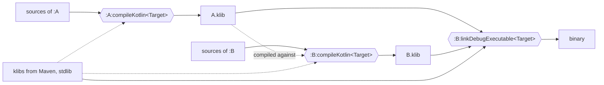
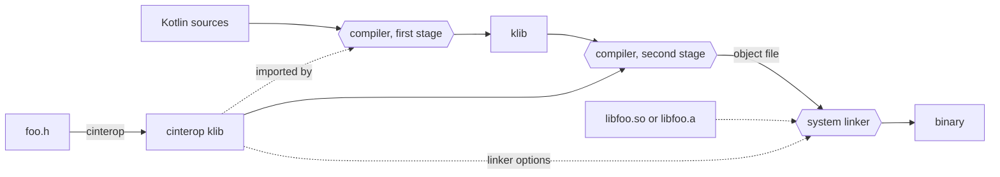
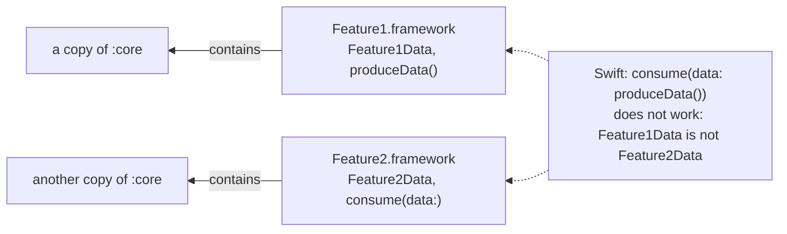

# The compilation model: the outside view

How a Kotlin/Native build looks from the outside: which artifacts exist and which compiler invocation produces which. This
is what a Gradle user sees. What happens inside one invocation is in [compiler/](README.md).

Building a binary in project `:B`, which depends on project `:A`. Each hexagon is one invocation of the compiler.

- **"compile" tasks run the first stage**: sources → klib. A **klib** holds the library as metadata plus Kotlin IR, with no
  machine code. Klibs are what gets published, and what dependencies from Maven are. → [klibs-and-linking.md](klibs-and-linking.md)
- **"link" tasks run the second stage**: all klibs → binary. Despite the name, this is where all code generation happens:
  the task takes the complete set of klibs, translates them to machine code and adds the runtime.

## The closed world

A binary always contains everything it needs: its own code, all dependencies, the stdlib and the runtime. The compiler
relies on seeing all of it at once, so two Kotlin/Native binaries never share Kotlin code through, say, a common dynamic
library. Each one is a separate, closed "world" with its own runtime.

## Kinds of binaries

| Kind | `-produce` | What you get |
|---|---|---|
| Executable | `program` | `name.kexe` (or `.exe`), which calls `fun main` |
| Test executable | `program` with `-generate-test-runner` | An executable that runs all `@Test` functions. Gradle test tasks use it |
| C library | `dynamic`, `static` | `libname.so` / `.dylib` / `.dll` or `libname.a`, plus a generated C header → [export.md](../interop/export.md) |
| Objective-C framework | `framework` | `Name.framework` with the library, a generated header and metadata. Usable from Swift → [export.md](../interop/export.md) |
| Klib | `library` | Not a binary: the output of the first stage |

## Why "link" is slow, and what helps

The second stage compiles the whole world every time, so it is the slow part of a build. Two mechanisms reuse machine code
from earlier runs. Both work for debug binaries only, because release binaries (`-opt`) get whole-program optimizations,
which cannot be done piece by piece. → [caches.md](caches.md)

- **Compiler caches.** Each dependency klib is compiled once into a static library (`.a`) plus some extra information,
  for example class layouts. It is stored on disk and reused by every later build. The compiler keeps separate caches for
  settings that change the machine code, such as the choice of GC. Only libraries that never change are cached this way:
  the stdlib, platform libraries, dependencies from Maven.
- **Incremental compilation** (experimental). The same idea for the project's own code, with one cache per source file.
  After a change, only the changed files and the files that depend on them are compiled again.

## Using C and Objective-C from Kotlin: cinterop

The `cinterop` tool reads C or Objective-C headers and produces a **cinterop klib**: Kotlin declarations for what the
headers declare. The compiler accepts it as a dependency like any other klib. The headers describe only the API, so the
library's actual code still has to reach the linker. Swift and C++ libraries cannot be imported directly: they must be
exposed through Objective-C (`@objc`) or C wrappers first. → [cinterop.md](../interop/cinterop.md)

## Using Kotlin from Objective-C, Swift and C

The compiler produces a framework or a C library, as listed above, with a generated header and bridging code. Swift uses
the Objective-C framework; a direct **Swift export** is being developed. → [export.md](../interop/export.md), [swift-export](../../swift-export/README.md)

## Two frameworks are two worlds

If frameworks `Feature1` and `Feature2` are built from projects that both depend on `:core`, each contains its own copy of
`:core` and its own runtime. A `Data` object from one is a different type for the other:

The fix is one **umbrella framework** that includes all the Kotlin projects the application needs.

## Things to know

- **"Link" does not mean linking.** In Gradle, `link...` tasks run the whole backend. In this guide, "linking" is either
  IR linking (connecting klibs) or the system linker.
- **Debug and release builds exercise different compiler code.** Release builds use no caches and run the whole-program
  optimizations. `konanc` can also run both stages in one command (`konanc main.kt -o main`); Gradle never does that.

## Where the code is

- [K2Native.kt](../../../native/cli-native/src/org/jetbrains/kotlin/cli/bc/K2Native.kt): the entry point of the compiler.
- [CompilerOutputKind.kt](../../../native/utils/src/org/jetbrains/kotlin/konan/target/CompilerOutputKind.kt): output kinds.
- [CacheBuilder.kt](../../../kotlin-native/backend.native/compiler/ir/backend.native/src/org/jetbrains/kotlin/backend/konan/CacheBuilder.kt):
  where caches and incremental compilation start.
- [kotlin-native/Interop/StubGenerator](../../../kotlin-native/Interop/StubGenerator): the `cinterop` tool.
