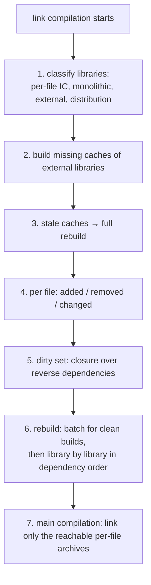
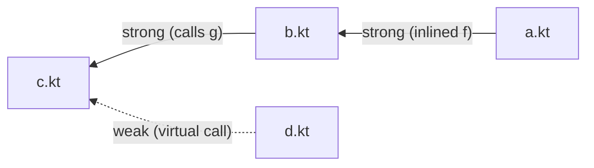

[Kotlin/Native guide](../README.md) › [compiler](README.md) › [incremental compilation](incremental-compilation.md) › in depth

# Incremental compilation in depth

*Skip this page if you can explain how the dirty set is computed, what a weak dependency is, and how the final binary
picks its per-file archives. Read [incremental-compilation.md](incremental-compilation.md) and [caches.md](caches.md)
first.*

This page describes the algorithms of second-stage incremental compilation (IC): how a change is detected, how it
spreads to other files, in what order caches are rebuilt, and how the binary is assembled from them. All of it runs at
the start of a link compilation (`CacheBuilder`), before the main compilation, which then sees every library as cached.



## The units of work

- A **library** is a klib. IC applies to the libraries given to the compiler explicitly (`-library`, `-Xinclude`), other
  than the stdlib and cinterop libraries. In Gradle these are the project's own klibs. Libraries under the Gradle user
  home (`-Xauto-cache-from`) are **external**: they get one shared, monolithic cache each.
- A **file** is a source file of a library, identified by `<package>.<hash of its path>`, for example
  `kotlin.collections.1lhofm`. Each file has a cache directory of its own, with an archive (`bin/lib<id>.a`), its
  dependencies (`bin/bitcode_deps`), its hash (`metadata.properties`) and side information (`ir/`).
- A **cache build** is a separate compilation that the compiler spawns, in the same JVM, for one library:
  `-Xadd-cache=<lib> -Xmake-per-file-cache -Xfile-to-cache=<dirty file>...`. Without `-Xfile-to-cache` every file is
  compiled. Inside it each file is a [fragment](README.md#fragments-and-output-kinds): lowerings run over all files
  together, then code generation and LLVM run per file, in parallel (`-Xbackend-threads`).

Files of a library that are not being rebuilt are loaded like any other cached library: declaration headers only, no
bodies. So a cache build of three dirty files out of three hundred lowers and compiles three files.

## Detecting a change

**The file hash.** A file's hash is computed from its serialized IR inside the klib, not from the source text: a chained
[CityHash128][cityhash] over the file's sections, in the order file proto, types, signatures, string literals, bodies, file
entries, declarations (`SerializedIrFileFingerprint`). It is stored in the file's `metadata.properties` when the cache is
built, and recomputed from the klib on the next build. Source offsets are part of the IR, so moving code changes the hash.

The first stage always rebuilds a klib in full, so this scheme relies on serialization being deterministic: a file that
did not change must serialize to the same bytes.

**Classifying files.** For each per-file library, the cached file ids are compared with the files of the current klib:

| Cached | In the klib | Classified as |
|---|---|---|
| yes | no | **removed** |
| yes | yes, different hash | **changed** |
| yes | yes, but its `bitcode_deps` names a library that is no longer there | **changed** (KT-61644) |
| no | yes | **added** |

**Stale caches.** Some changes invalidate the whole cache of a library. The fingerprints in `metadata.properties` are
compared with the current ones. All files of a cache are built against the same compiler and dependencies, so the
metadata of one file, picked arbitrarily, stands for the whole cache. The library is rebuilt in full if:

- there is no metadata (a cache from a compiler older than 2.2.20);
- the **compiler fingerprint** differs;
- the **dependencies fingerprint** differs: a hash over the monolithically cached dependencies of the library, that is,
  external and cinterop libraries. Their declarations are not tracked per file, so any change in them is a change for the
  whole library;
- the companion-initialization mode differs.

A full rebuild also happens for every library that transitively depends on an external library whose cache was just
built: a depth-first walk over the reverse library graph. Options that change generated code are not checked here at all:
they are part of the cache directory name (the flavor, see [caches.md](caches.md#when-a-cache-is-thrown-away)), so a
different value starts in an empty directory.

## The dependency graph

While a file is compiled, the compiler records every other file whose content it relies on (`DependenciesTracker`). After
code generation the list is written to `bin/bitcode_deps`, one line per dependency:

```
app|main.kt's id            ← not recorded: a file does not depend on itself
lib|                        ← the whole library lib
lib|com.example.2xk1fa      ← a file of lib: strong
lib|com.example.9ab3cd@weak ← a file of lib: weak
```

Almost all edges are recorded in one place: when code generation declares an **external function**, a function defined
outside the current file, it records the file that owns the function. The other sources are facts that leave no call
behind:

| What the file uses | Why it needs an edge |
|---|---|
| A function or property accessor of another file | It calls the symbol; the most common edge |
| The type info of a class of another file | Allocation, type checks, and the RTTI of a subclass refer to it. The subclass also needs the field layout of its superclass |
| An inline function of another file | The body was copied in; no symbol is left that would show the dependency. Recorded at every inlined block, including nested ones, so transitive inlining is covered |
| An enum entry of another file in `when` | The ordinal is baked in as a constant |
| A private field of another file through a cache-ABI accessor | See [CachesAbiLowering](caches.md#cachesabilowering) |
| A cinterop library, C stubs that need a library's native code | Whole-library edge |
| An Objective-C class from another file | Superclasses and protocols of Kotlin classes exported to Objective-C |

A **weak** edge means "needs this file at link time, but the generated code does not depend on its content". The only
weak edges come from virtual calls. A virtual call goes through a trampoline named after the class's function, which the
class's own file defines. If the implementation changes, the trampoline's name stays the same, so the caller does not need
to be recompiled. It only needs the file in the binary.

A **whole-library** edge is recorded for cinterop libraries, where the IR does not correspond to source files.

## Computing the dirty set

The dirty set is the closure of the changed files under reverse strong edges, over all IC libraries at once:

```
reverse[f]     = files with a strong edge to f       (read from every cached bitcode_deps)
reverseWeak[f] = files with a weak edge to f

visit(f):  dirty += f;  for g in reverse[f]: if g ∉ dirty: visit(g)

for f in removed:  visit(f);  for g in reverseWeak[f]: visit(g)
for f in changed:  visit(f)
dirty += added
dirty -= removed;  delete the caches of removed files
```

Example: `a.kt` inlines `f()` from `b.kt`, `b.kt` calls `g()` from `c.kt`, and `d.kt` makes a virtual call to a method
of a class in `c.kt`.



| Edited | Rebuilt | Why |
|---|---|---|
| `b.kt` | `b.kt`, `a.kt` | `a.kt` holds a copy of `f()` |
| `c.kt` | `c.kt`, `b.kt`, `a.kt` | `b.kt` calls `g()`; `a.kt` because `b.kt` changed |
| `c.kt` is deleted | `b.kt`, `a.kt`, `d.kt` | `d.kt` too, because its `bitcode_deps` would name a file that no longer exists |
| `d.kt` | `d.kt` | Nothing depends on it |

The rules behind the algorithm:

- **Strong edges propagate.** A strong edge means the dependent's code was generated from facts about the dependency.
  This is over-approximate: a changed function body also rebuilds callers whose code did not depend on that body.
- **Weak edges propagate only on removal.** The dependent's code is still right, but its `bitcode_deps` must not name a
  file that is gone.
- **Added files do not propagate.** No cached file can depend on a file that did not exist. If a declaration moved into
  the new file, the file it moved from changed, and its dependents are rebuilt through that file.
- **Whole-library edges are not followed.** A change in such a library makes the dependents stale through the
  dependencies fingerprint instead, so the whole dependent library is rebuilt.

## Rebuild order and batching

Libraries are rebuilt in reverse topological order, dependencies first, so a library is always compiled against caches
that are already up to date. Within a library all dirty files go to one cache build. In it, the dirty files are loaded
as full IR, and the clean files of the same library are loaded from their caches, like another library's. That cache
may be incomplete: the directories of added files do not exist yet. Only IC and the cache build of the library itself
accept an incomplete cache.

**Batching.** On a clean build every library needs a full cache build, and each would load the stdlib and the common
dependencies again. With `-Xbinary=batchedCacheBuild` (on by default) the libraries that need a full build and depend only
on each other or on up-to-date caches are built in one compilation, which loads the common dependencies once. The IR
linker binds each signature to one declaration, so two libraries that declare the same top-level signature (for example
an `internal` function with the same name in the same package) cannot share a batch. The batch is split into groups
without such clashes, built one after another.

## Compiling against a cache without bodies

A file compiled against cached code sees declarations, not bodies, and it sees them as they are in the klib, before
lowering. Some answers that normally come from bodies or from lowered IR are therefore stored by the cache build in
`ir/`:

| File | What it holds | Who needs it |
|---|---|---|
| `inline_bodies` | For each public inline function: where its body is in the klib | The inliner of a dependent file reads the body from the klib on demand |
| `class_fields` | The fields of each class after lowering, with types and alignment | The layout of a subclass in another file. Lowering adds fields, such as the outer `this` of an inner class, so the klib's list is not enough |
| `eager_init` | Files with `@EagerInitialization` properties | The final binary links them even when nothing refers to them |
| `trivial_getters` | `val` getters that only return a field | Cast optimization relies on two calls of such a getter returning the same value |
| `objc_adapters` | Objective-C adapters of the file's exported classes | The final binary emits them |
| `pl_issues` | [Partial linkage][pl] problems found while compiling the file | Reported again by every build that links the file |

Private declarations that dependents still need after lowering are reached through accessors that both sides generate
by the same naming rule: [CachesAbiLowering](caches.md#cachesabilowering).

## Inline functions, end to end

Inline functions are the case where a change in one file changes the machine code of another.

1. `f` in `b.kt` is edited, so `b.kt`'s IR in the klib changes and so does its hash. `b.kt` is changed.
2. `a.kt` inlined `f` in an earlier build, so it has a strong edge to `b.kt`. It becomes dirty.
3. `b.kt`'s library is rebuilt first: its `inline_bodies` now points at the new body in the new klib.
4. `a.kt` is compiled against that cache and inlines the new body.

Across libraries this works because the dirty set is computed over all IC libraries together. If `f` itself inlined `g`
from `c.kt`, `a.kt` holds a copy of `g` too, and records an edge to `c.kt` as well. Inlining inside one klib already
happens in the first stage, and changes the hash of the caller's own file directly.

## Assembling the binary

The main compilation compiles almost nothing itself: all libraries are cached. It computes which archives to link as a
forward closure over `bitcode_deps`:

1. Start from the files the main compilation's own code refers to, plus the `eager_init` files of every library it uses.
2. Add the `bitcode_deps` of each of those files, transitively. A whole-library edge adds every archive of that library.
3. The library being linked (`-Xinclude`) always contributes all its files.

The system linker gets exactly these per-file archives. A file of a dependency that nothing reaches is not linked.

## Writing caches safely

- Each file of a cache build writes into a temporary directory, which is renamed into place when that file is done. If
  the old directory exists, it is renamed away and deleted first. This is two renames, not one atomic step. Files are
  finished in parallel, so another file of the same build may look for the directory in between. It does not need the
  old content, because the file is being rebuilt from IR, and the code that selects caches skips it.
- If a cache build fails, the whole cache of the library is deleted, so the next build compiles that library from scratch.
- Shared external caches are built under a file lock, because several projects use them. IC caches are not locked: one
  build directory is not built by two compilations at once.

## Limitations

- **Over-approximation.** Dependencies are per file and do not record what was used. Any change to a file rebuilds
  everything that depends on it, even a change to a function the dependents never called.
- **Monolithic libraries.** A change in a cinterop library of the project rebuilds the whole cache of every library that
  depends on it.
- **No IC with `-opt`.** Release builds do not use IC, even with release caches enabled.
- **Linux is off by default in Gradle** because of clashing declarations (KT-81760).
- **Whole-library reverse edges are collected but not used** for the dirty set. They are covered by the dependencies
  fingerprint.

## Tests

Each test in `native/native.tests/testData/caches/ic/<group>/<case>/` is a small project built in steps:

```
project.info               MODULES: lib, main          STEP 0: libs: lib, main     STEP 1: ...
lib/module.info            STEP 1:
                               modifications:  U : file1.1.kt -> file1.kt       (replace file1.kt with file1.1.kt)
                               modified cache: file1.kt, file2.kt               (exactly these are rebuilt)
lib/file1.kt, file1.1.kt   the sources of each step
```

Each step compiles the klibs, links `main` with IC, checks which per-file caches were added, modified, left unchanged or
removed, and runs the program. A missing dependency edge shows up as an "unchanged cache" that should have been modified,
or as a wrong result. Run them with `./gradlew :native:native.tests:cachesTest`. `CacheBatchTest` covers batching, and
`NativeIncrementalCompilationIT` covers the Gradle side.

## Where the code is

- [CacheBuilder.kt](../../../kotlin-native/backend.native/compiler/ir/backend.native/src/org/jetbrains/kotlin/backend/konan/CacheBuilder.kt):
  everything up to the main compilation. `build()` is the algorithm of this page, in order.
- [DependenciesTracker.kt](../../../kotlin-native/backend.native/compiler/ir/backend.native/src/org/jetbrains/kotlin/backend/konan/DependenciesTracker.kt):
  recording edges, writing `bitcode_deps`, and choosing the archives for the final link (`CachedBitcodeDependenciesComputer`)
- [FileFingerprints.kt](../../../compiler/ir/serialization.common/src/org/jetbrains/kotlin/backend/common/serialization/FileFingerprints.kt):
  the file and klib hashes
- [CacheInfoBuilder.kt](../../../kotlin-native/backend.native/compiler/ir/backend.native/src/org/jetbrains/kotlin/backend/konan/lower/CacheInfoBuilder.kt),
  [CacheStorage.kt](../../../kotlin-native/backend.native/compiler/ir/backend.native/src/org/jetbrains/kotlin/backend/konan/CacheStorage.kt):
  collecting and writing the side files
- [AbstractNativeIncrementalCompilationTest.kt](../../../native/native.tests/testFixtures/org/jetbrains/kotlin/konan/test/blackbox/AbstractNativeIncrementalCompilationTest.kt):
  the test runner

[cityhash]: https://github.com/google/cityhash
[pl]: https://kotlinlang.org/docs/whatsnew19.html#library-linkage-in-kotlin-native
