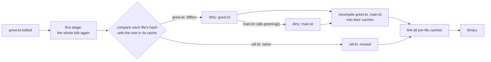

[Kotlin/Native guide](../README.md) › [compiler](README.md) › incremental compilation

# Incremental compilation: rebuilding only what changed

*Skip this page if you know which files an incremental build recompiles, why, and when Gradle turns it on.*

[Caches](caches.md) make the second stage skip libraries that did not change. **Incremental compilation (IC)** goes one
step further for the project's own klibs: it keeps one cache **per source file** and, on the next build, recompiles only
the files that changed and the files that depend on them. Everything else is linked from the previous build.

A real run with three files, `util.kt` (`square`), `greet.kt` (`greeting`) and `main.kt` (calls both), built with
`-Xenable-incremental-compilation -Xic-cache-dir=cache`. After editing only `greet.kt`:

The second build took 2.3 s and rebuilt two of the three caches: the one for `greet.kt` and the one for `main.kt`.

## What happens

- **A file has changed** when the hash of its IR in the klib differs from the hash stored in its cache. The IR is hashed,
  not the source text. Source offsets are part of the IR, so a change that only moves code, such as a longer comment
  above it, still counts.
- **Dependents are recompiled too.** While a file is compiled, the compiler records which other files its code relies on:
  functions it calls, classes it allocates or checks against, inline functions it inlined, enum entries whose ordinal it
  baked in. They are stored next to the file's machine code (`bitcode_deps`). A changed file makes every file that
  depends on it dirty, transitively, also across libraries of the project.
- **A deleted file** has its cache deleted, and the files that depended on it are recompiled. A new file is compiled, and
  nothing else is.
- **Some changes rebuild everything.** A different compiler, different options that affect generated code, or a changed
  library that is not compiled per file (see below) make the whole cache of the dependent libraries stale.

## Which libraries, and when

| Library | How it is cached |
|---|---|
| The project's own klibs: the one being linked and other projects of the build | Per file, incrementally |
| Dependencies from Maven, cinterop libraries of the project | One cache for the whole library, rebuilt in full when the library changes |
| stdlib and platform libraries | Cached in the distribution, never rebuilt |

In Gradle IC runs in the link tasks of **debug** binaries. Its cache is `build/kotlin-native-ic-cache/<binary>/`. The
switch is the Gradle property `kotlin.incremental.native`. It is on by default for all targets except Linux, because of
clashing declarations (KT-81760). Release binaries (`-opt`) never use IC.

**The first stage is not incremental.** A changed project gets its whole klib rebuilt. That is cheap compared to the
second stage. The first stage is deterministic, so files that did not change keep their hashes, and the second stage
sees them as unchanged.

## Things to know

- **A bug that appears only after an incremental build** usually means a missing dependency: some code used a fact about
  another file without recording it. Compare with a clean build (delete the IC cache directory). A lowering that copies
  such a fact into the current file must call `dependenciesTracker.add`.
  → [before-you-change.md](../reference/before-you-change.md)
- **A new compiler throws away all IC caches.** Each cache records the compiler's fingerprint.
- **`-Xic-cache-dir` also works by hand.** `konanc -Xinclude=app.klib -o app -Xenable-incremental-compilation
  -Xic-cache-dir=cache -verbose` prints which files were changed, added, removed and rebuilt.
- **Tests**: the `caches/ic` test data, run with `./gradlew :native:native.tests:cachesTest`.
  → [tests.md](../build-and-tests/tests.md)

## Where the code is

- [CacheBuilder.kt](../../../kotlin-native/backend.native/compiler/ir/backend.native/src/org/jetbrains/kotlin/backend/konan/CacheBuilder.kt):
  finds what changed and rebuilds it, before the main compilation
- [DependenciesTracker.kt](../../../kotlin-native/backend.native/compiler/ir/backend.native/src/org/jetbrains/kotlin/backend/konan/DependenciesTracker.kt):
  records the dependencies of each file
- [KotlinNativeLink.kt](../../../libraries/tools/kotlin-gradle-plugin/src/common/kotlin/org/jetbrains/kotlin/gradle/targets/native/tasks/KotlinNativeLink.kt):
  where Gradle turns IC on

## Go deeper

| Page | What it explains |
|---|---|
| [incremental-compilation-in-depth.md](incremental-compilation-in-depth.md) | The algorithms: hashing, the dependency graph, the dirty set, rebuild order, assembling the binary |
| [caches.md](caches.md) | What a cache holds and why caches and whole-program optimizations do not mix |
