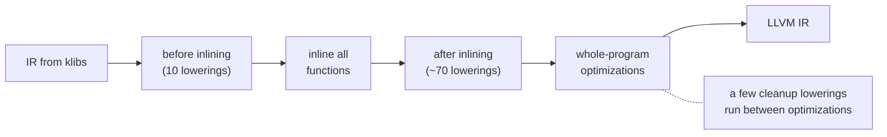

[Kotlin/Native guide](../../README.md) › [compiler](../README.md) › lowerings

# Lowerings

*Skip this page if you know what a lowering is and that Native runs them per file, around the inliner.*

A **lowering** rewrites Kotlin IR into simpler Kotlin IR. Each one removes a language feature (enums, lambdas, `suspend`,
default arguments, …) by expressing it through plainer constructs. After the last lowering the IR contains only what LLVM code
generation understands: classes with fields, functions, calls, branches, loops and `try`/`catch`.

```kotlin
// what you write                      // what code generation sees (roughly)
enum class Color { RED, BLUE }         class Color : Enum<Color> { static val $VALUES: Array<Color> ... }
val f = { x: Int -> x + 1 }            class main$f$0 : Function1<Int, Int> { fun invoke(x: Int) = x + 1 }
fun greet(name: String = "you")        fun greet$default(name: String?, mask: Int) { ... }
```

## When they run

Almost all lowerings run in the second stage (klibs → binary), one file at a time, in a fixed order. The inliner splits them
into two lists:



- **Per file.** A lowering sees one file and may only change that file. Other files may be at a different step.
- **The inliner is the exception.** It copies function bodies across files, so every file is first brought to the same point
  (everything before inlining is done), and only then inlining starts.
- **A few lowerings run in the first stage** (sources → klib), before the IR is written to the klib. Their result is stored in
  the klib, so there are few of them. Inlining is one: with the current default language version, inline functions are
  already inlined in the klib, and the second-stage inliner only has work left for klibs built with an older one.

To see what a lowering does to your code, dump the IR around it:
`-Xphases-to-dump-before=EnumClassLowering -Xphases-to-dump-after=EnumClassLowering`. The phase name is the class name.

## Theme pages

Lowerings that work on the same feature are described together, in the order they run:

| Page | What the group does |
|---|---|
| [inlining.md](inlining.md) | Inline functions, `reified` type parameters, `typeOf`, `::class` |
| [callable-references.md](callable-references.md) | Lambdas, function and property references, SAM conversions |
| [classes-and-local-declarations.md](classes-and-local-declarations.md) | Local functions and classes, captured variables, inner classes, data classes, annotations, `@Volatile` |
| [enums.md](enums.md) | Enum classes, entries, `when` over an enum |
| [control-flow.md](control-flow.md) | `for` loops, `finally`, `tailrec` |
| [functions.md](functions.md) | Default arguments, `vararg`, constructors |
| [casts-and-types.md](casts-and-types.md) | `as`, `is`, `==`, and keeping expression types precise |
| [boxing.md](boxing.md) | Boxing of primitives and value classes, bridge functions |
| [interop.md](interop.md) | Calls to C and Objective-C |
| [tests-and-assertions.md](tests-and-assertions.md) | `@Test` functions and `assert` |
| [coroutines](../../features/coroutines.md), [initialization](../../features/initialization.md), [caches](../caches.md) | Lowerings described with the feature they implement |

## Looking up one lowering

[all-lowerings.md](all-lowerings.md) lists every lowering in the order it runs, with one line on what it does and a link to
its section.
