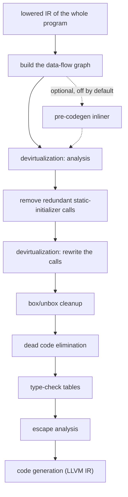

# Whole-program optimizations

When you compile with `-opt`, the second stage runs a group of optimizations on Kotlin IR after the
[lowerings](../lowerings/README.md) and before [code generation](../codegen.md). They all rely on one fact: at this point the
compiler holds the IR of the entire program (your code, the stdlib, every dependency) and nothing else will be added later.
This is the **closed world**. In a closed world the compiler can answer questions that a separately compiled module cannot:
which classes are ever created, which functions are ever called, which objects never leave the function that creates them.

**Why on Kotlin IR and not in LLVM?** LLVM optimizes well, but it knows nothing about Kotlin (see
[llvm-primer.md](../../llvm-primer.md)). In LLVM IR a virtual call is "load a pointer from a table and jump to it", a class is a
constant with some pointers in it, and `Circle(1.0)` is a call to a runtime function named `AllocInstance`. The knowledge
that only two classes implement an interface, or that an allocation could live on the stack, is gone by then. So these
decisions are made while the program is still classes and calls, and LLVM gets the simplified result.

## What runs, in order



| Step | What it does |
|---|---|
| Data-flow graph | Builds a simplified model of the whole program that the analyses below share. See the next section. |
| Pre-codegen inliner | Copies small functions into their callers so that the analyses see more in one place. Off by default; enabled with the binary option `preCodegenInlineThreshold`. When on, it runs again after devirtualization, to inline the calls that became direct. Not related to Kotlin's `inline` keyword, which was handled by a lowering much earlier. |
| [Devirtualization](devirtualization.md) | Finds which classes can reach each virtual call and replaces the call with a direct call or a small `when` over the object's class. |
| Static-initializer calls | After lowering, every function that touches a top-level property starts with "initialize this file if not done yet" (→ [initialization.md](../../features/initialization.md)). This step removes the check wherever a caller has certainly done it already. In the sample used on the pages below, only `main` keeps it. |
| Box/unbox cleanup | Removes places where a primitive value is boxed and immediately unboxed again. The rewrites above tend to leave such pairs behind. |
| [Dead code elimination](dce.md) | Deletes every function that cannot be reached from the program's entry points. |
| [Type-check tables](type-checks.md) | Numbers all classes and interfaces so that `is` and `as` cost a couple of comparisons. |
| [Escape analysis](escape-analysis.md) | Finds objects that never outlive the function that creates them; code generation puts those on the stack. |

## The data-flow graph

Devirtualization, dead code elimination and escape analysis all ask variants of one question: **which values can flow
where?** Answering it on full IR, with its branches, loops and dozens of expression kinds, would be slow and complicated.
So the compiler first builds, once, a much simpler model of each function. It keeps only what matters for that question:
parameters, allocations, calls, field reads and writes, returns and throws. It drops the rest: the order of statements,
conditions, arithmetic.

```kotlin
fun report(logger: Logger, s: Shape) {
    logger.log("area = " + describe(s))
}
```

This is the model of `report` as the compiler prints it (with `-Xverbose-phases=BuildDFG`), shortened:

```
NODE #7  PARAM 0                                        // logger
NODE #8  PARAM 1                                        // s
NODE #1  CONST String                                   // "area = "
NODE #2  STATIC CALL describe(Shape)        ARG #8      // s flows into describe
NODE #3  STATIC CALL Double.toString()      ARG #2
NODE #4  STATIC CALL String.plusImpl(...)   ARG #1  ARG #3
NODE #5  INTERFACE CALL Logger.log(String)  ARG #7  ARG #4      // receiver is whatever flows into parameter 0
```

Each node is a value; `ARG #n` says "the value of node n flows into this call". Connect such graphs across all functions
(the argument of a call flows into the callee's parameter, its return value flows back) and you can follow any object from
the place it is allocated to every place it is used:

- Devirtualization asks: which allocations can flow into the receiver of node #5? If only `ConsoleLogger` objects can, the
  interface call can become a direct call.
- Escape analysis asks: can the string from node #4 be stored somewhere that outlives `report`?
- Dead code elimination asks: which functions appear in a call node of some reachable function?

Because order and conditions are dropped, the answers are approximate, always on the safe side: a value is assumed to flow
somewhere if any path through the function could take it there. In the source code this model is called **DFG** or
`DataFlowIR`. When an optimization rewrites a function's IR, it rebuilds that function's graph, so later steps see the
improved program.

## Things to know

- **Only with `-opt`.** Debug builds skip all of this, which keeps them fast to compile.
- **Not with precompiled libraries.** If some of the program was compiled earlier into a static [cache](../caches.md), the
  world is no longer closed: the cached machine code cannot be analysed or changed. The compiler then turns off every step
  on this page, even with `-opt`. Fast type checks are affected too.
- **A library is a half-open world.** When the output is a framework or a dynamic/static library there is no `main`. Every
  public function may be called from outside with any arguments, so the analyses must assume more and find less.
- **Bugs here show up only in release builds.** If a program misbehaves with `-opt` and works in debug, switch off one
  step at a time with `-Xdisable-phases=<name>`. The names are `Devirtualization`, `DCEPhase`, `EscapeAnalysis`,
  `RemoveRedundantCallsToStaticInitializersPhase`, `GHAPhase`.
- **To look at the result**, dump IR after a step with `-Xphases-to-dump-after=Devirtualization` (see the
  [tour](../../tour.md#try-it-yourself)), or compare the LLVM IR of a debug and an `-opt` build.
- LLVM's own optimizations run later, on the generated LLVM IR, and are a separate topic (→ [codegen.md](../codegen.md)).

## Where the code is

- [TopLevelPhases.kt](../../../../kotlin-native/backend.native/compiler/ir/backend.native/src/org/jetbrains/kotlin/backend/konan/driver/phases/TopLevelPhases.kt):
  function `runCodegen` is the exact order of the steps and the conditions under which each runs.
- [LTO.kt](../../../../kotlin-native/backend.native/compiler/ir/backend.native/src/org/jetbrains/kotlin/backend/konan/driver/phases/LTO.kt):
  the phase definitions (name, input, output) for each step.
- [optimizations/](../../../../kotlin-native/backend.native/compiler/ir/backend.native/src/org/jetbrains/kotlin/backend/konan/optimizations/):
  the implementations. `DataFlowIR.kt` and `DFGBuilder.kt` are the data-flow graph, `CallGraphBuilder.kt` the call graph
  derived from it.
- [StaticInitializersOptimization.kt](../../../../kotlin-native/backend.native/compiler/ir/backend.native/src/org/jetbrains/kotlin/backend/konan/optimizations/StaticInitializersOptimization.kt):
  removal of redundant initializer calls. Its header comment explains the approach.

**Read next:** [devirtualization](devirtualization.md), then
[escape analysis](escape-analysis.md), [dead code elimination](dce.md) and
[type checks](type-checks.md).
