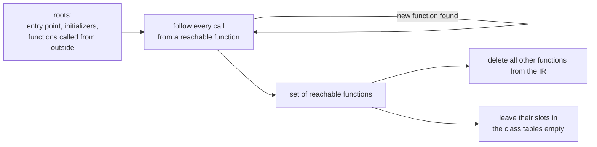

# Dead code elimination

The second stage compiles your code together with the whole standard library and all dependencies. A typical program uses
a small part of them. Dead code elimination (**DCE**) removes every function the program can never call, before any LLVM IR
is generated for it. It is one of the [whole-program optimizations](README.md) and runs only with `-opt`.

The effect on a 50-line sample program (a few classes, a list, some `println` calls), counted as the number of functions
in the LLVM IR after code generation and as the size of the final executable on Linux x64:

| Build | Functions that reach code generation | Executable |
|---|---|---|
| debug | 5466 | 735 KB |
| `-opt`, with DCE switched off (`-Xdisable-phases=DCEPhase`) | 5442 | 610 KB |
| `-opt` | 1954 | 564 KB |

Almost two thirds of the functions are never generated. This saves binary size and, just as important, compile time: LLVM
does not have to optimize and emit machine code for them.

## How it works



1. **Start from the roots**: functions that can be called without any Kotlin code calling them (list below).
2. **Follow the calls.** Using the [data-flow graph](README.md#the-data-flow-graph), collect every function
   called from an already reachable one, and repeat until nothing new is found.
3. **Delete the rest** from the IR. Code generation never sees those functions.

Direct calls are simple. The interesting part is virtual calls: `shape.area()` could run any override of `area`. Keeping
all overrides in the program would keep far too much, so DCE uses the result of
[devirtualization](devirtualization.md), which has computed for each virtual call the set of classes the receiver can
have. Only the overrides in those classes are kept:

```kotlin
interface Shape { fun area(): Double }
class Circle(val r: Double) : Shape { override fun area() = 3.14 * r * r }      // created in main: area() is kept
class Triangle(val a: Double, val h: Double) : Shape {                          // never created anywhere:
    override fun area() = a * h / 2                                             // area() is removed
}
fun unused(x: Int) = x * 42                                                     // no caller: removed
```

This is the reason DCE runs after devirtualization, and the reason it removes much more than a linker could: a linker sees
that `Triangle.area` is referenced from the class's function table and must keep it.

### What happens to the tables

Every class has a table of its virtual functions, used for virtual calls (→ [object-model.md](../../runtime/object-model.md)). The
layout of the table must not change when a function is removed, so the slot of a removed function is filled with `null`.
In the sample, the table of the stdlib class `ArrayList` has 27 slots; in the `-opt` build 13 of them are `null`:

```llvm
@"kclass:kotlin.collections.ArrayList" = constant { ... } { ...,
  [27 x ptr] [ptr @"kfun:kotlin.collections.ArrayList#equals(kotlin.Any?){}kotlin.Boolean",
              ...
              ptr @"kfun:kotlin.collections.ArrayList#iterator(){}kotlin.collections.MutableIterator<1:0>",
              ptr null,                                         ; a function nobody can call: removed
              ptr null, ...] }
```

## The roots

For an executable:

- the entry point `main` (the runtime reaches it through a generated wrapper, `Konan_start`);
- initializers of top-level properties and objects (→ [initialization.md](../../features/initialization.md));
- Kotlin functions that the C++ runtime calls by name. They are marked in the stdlib with annotations such as
  `@ExportForCppRuntime`;
- functions whose address is handed to native code, for example a callback created with `staticCFunction`;
- objects that can be looked up through reflection with `findAssociatedObject`.

For a framework or a library there is no single entry point: **every public function is a root**, and so is every function
that sits in a class's function table, because code outside can call them. DCE still runs but removes much less.

## Things to know

- **A missing root is a crash, not a compile error.** If the compiler wrongly decides that a function is unreachable and
  it is called anyway through a table, the program jumps to address 0. If code that works in debug crashes like this
  with `-opt`, try `-Xdisable-phases=DCEPhase` to confirm.
- **DCE removes functions only.** Classes and their descriptions are not removed by this step.
- **Debug builds do not run DCE**, and neither do builds that link precompiled [caches](../caches.md): code in a cache is
  already compiled and cannot be trimmed for one particular program.
- **It is imprecise in the safe direction.** It does not look at conditions, so a call in a branch that is never taken at
  run time still keeps its target alive.

## Where the code is

- [DCE.kt](../../../../kotlin-native/backend.native/compiler/ir/backend.native/src/org/jetbrains/kotlin/backend/konan/optimizations/DCE.kt):
  the whole step, under 100 lines.
- [CallGraphBuilder.kt](../../../../kotlin-native/backend.native/compiler/ir/backend.native/src/org/jetbrains/kotlin/backend/konan/optimizations/CallGraphBuilder.kt):
  finds what is reachable from the roots, including the handling of virtual calls.
- [DevirtualizationAnalysis.kt](../../../../kotlin-native/backend.native/compiler/ir/backend.native/src/org/jetbrains/kotlin/backend/konan/optimizations/DevirtualizationAnalysis.kt):
  function `computeRootSet` defines the roots.
- [RTTIGenerator.kt](../../../../kotlin-native/backend.native/compiler/ir/backend.native/src/org/jetbrains/kotlin/backend/konan/llvm/RTTIGenerator.kt):
  writes the class tables and puts `null` into the slots of removed functions.

**Read next:** [type-checks.md](type-checks.md)
