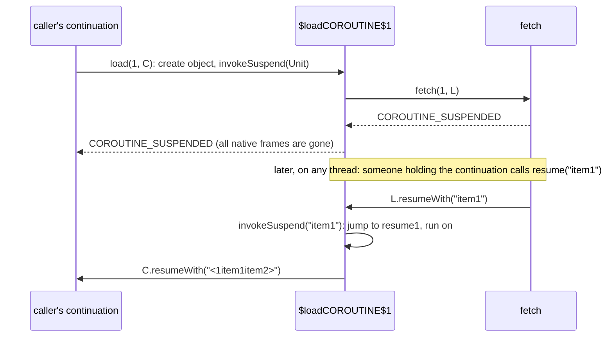

[Kotlin/Native guide](../README.md) › [features](README.md) › coroutines

# Coroutines: what a `suspend` function is compiled into

*Skip this page if you already know how a suspend function becomes a state object with spilled locals and a `label`.*

A [`suspend` function][keep] can stop in the middle, give its thread back, and continue later, possibly on another thread. A
native stack frame cannot do that, so the compiler rewrites every such function: its local state moves into a heap object,
and its body becomes a method that can be entered again at the place where it stopped. The runtime and the GC know nothing
about coroutines: they see ordinary objects and ordinary function calls.

```kotlin
suspend fun fetch(id: Int): String = suspendCoroutine { ... }   // may suspend

suspend fun load(id: Int): String {
    val prefix = "<" + id
    val a = fetch(id)             // suspension point 1
    val b = fetch(id + 1)         // suspension point 2
    return prefix + a + b + ">"
}

suspend fun tail(id: Int): String = fetch(id * 2)
```

## The rewrite, step by step

`NativeSuspendFunctionsLowering → NativeAddContinuationToFunctionCallsLowering → CoroutinesLivenessAnalysis →
(whole-program optimizations) → CoroutinesVarSpillingLowering → code generation`

In the snippets, `suspendable` and `suspensionPoint` stand for two special IR nodes (`IrSuspendableExpression`,
`IrSuspensionPoint`) that stay until code generation. The Kotlin-like IR dump cannot print them: use the default format.

### NativeSuspendFunctionsLowering

Turns a suspend function that has to pause in the middle into a **coroutine class**: its `invokeSuspend` method is the
old body, restartable at each suspension point.

```kotlin
suspend fun tail(id: Int): String = fetch(id * 2)           // unchanged: a tail call needs no state
suspend fun load(id: Int): String =                         // only creates the state object and runs the first part
    `$loadCOROUTINE$1`(id, getContinuation<String>()).invokeSuspend(Result(Unit))

private class `$loadCOROUTINE$1`(val id: Int, completion: Continuation<String>) : ContinuationImpl(completion) {
    private var label: NativePtr                            // where to resume; null on the first call
    override fun invokeSuspend(result: Result<Any?>): Any? {
        var suspendResult: Any?
        suspendable(label) {                                // "if label is set, jump to it"
            val prefix = "<" + this.id
            val a = suspensionPoint(id0) {
                saveCoroutineState(); label = id0
                suspendResult = fetch(this.id)
                if (suspendResult === COROUTINE_SUSPENDED) return suspendResult    // callee paused: so do we
                suspendResult                               // callee finished at once: go on with its value
            } resume { restoreCoroutineState(); result.getOrThrow() } as String    // entered here on resume
            val b = suspensionPoint(id1) { /* same shape, calls fetch(this.id + 1) */ } as String
            return prefix + a + b + ">"
        }
    }
}
```

- A function gets a class only if it has a suspend call that is not a [tail call][tailcall]. `tail` returns whatever `fetch`
  returns, so it has nothing to do after resumption. A call inside `try` is never a tail call.
- Parameters become fields at once. Local variables do not: `saveCoroutineState`/`restoreCoroutineState` are placeholders.

**Source:** [NativeSuspendFunctionLowering.kt](../../../kotlin-native/backend.native/compiler/ir/backend.native/src/org/jetbrains/kotlin/backend/konan/lower/NativeSuspendFunctionLowering.kt)
· **Runs:** after inlining, always.

### NativeAddContinuationToFunctionCallsLowering

A suspend function must know whom to resume when it finishes: the [**continuation**][cps] of its caller, hidden in source
code. The shared `AddContinuationToNonLocalSuspendFunctionsLowering` adds it as a last parameter to every suspend function;
this lowering, right after it, passes it at every call. From here on suspend functions are ordinary functions, which only
code that has a continuation to pass can call.

```kotlin
fun fetch(id: Int, `$completion`: Continuation<String>): Any = ...     // returns Any: a String or COROUTINE_SUSPENDED
fun tail(id: Int, `$completion`: Continuation<String>): Any = fetch(id * 2, `$completion`)    // hands over its own
fun load(id: Int, `$completion`: Continuation<String>): Any =
    `$loadCOROUTINE$1`(id, `$completion`).invokeSuspend(Result(Unit))  // was getContinuation()
// inside invokeSuspend:  fetch(this.id, this)       the coroutine object is the continuation of the calls it makes
```

**Source:** [NativeAddContinuationToFunctionCallsLowering.kt](../../../kotlin-native/backend.native/compiler/ir/backend.native/src/org/jetbrains/kotlin/backend/konan/lower/NativeAddContinuationToFunctionCallsLowering.kt)
· **Runs:** after inlining, always, right after `NativeSuspendFunctionsLowering`.

### CoroutinesLivenessAnalysis

Computes, for every suspension point, which local variables are read after it, and attaches the answer to the point. The
IR does not change. Only those variables must survive the suspension; fewer means a smaller object, less copying, and no
garbage kept alive by a suspended coroutine. In `load`: `prefix` at point 1, `prefix` and `a` at point 2. `id` is already
a field, and `b` is assigned after the last point.

- If this analysis (a [backward data-flow analysis][liveness] shared with other backends) is disabled as a phase,
  `CoroutinesLivenessAnalysisFallback` takes every variable visible at the point instead: correct, only wasteful.
- The result has two users: the data-flow graph of the whole-program optimizations, and the spilling below. With `-opt`,
  the pre-codegen inliner runs the analysis again on every function it inlined something into.

**Source:** [CoroutinesLivenessAnalysis.kt](../../../kotlin-native/backend.native/compiler/ir/backend.native/src/org/jetbrains/kotlin/backend/konan/lower/CoroutinesLivenessAnalysis.kt)
· **Runs:** after inlining, always, after `NativeSuspendFunctionsLowering`.

### CoroutinesVarSpillingLowering

Replaces the placeholders: saves the live variables into fields of the coroutine object before each suspension point and
loads them back after the resume (**spilling**). This is the final shape (real compiler output as pseudo-code; the
labels and `goto` show what code generation makes of the two special nodes):

```kotlin
private class `$loadCOROUTINE$1`(val id: Int, completion: Continuation<String>) : ContinuationImpl(completion) {
    var label: NativePtr
    var prefix: String                                  // new fields, one per spilled variable
    var a: String

    override fun invokeSuspend(result: Result<Any?>): Any? {
        if (label != null) goto label
        result.exceptionOrNull()?.let { throw it }
        var prefix = "<" + id                           // `val` became `var` so it can be reloaded

        this.prefix = prefix                            // --- suspension point 1: save
        this.label = &resume1                           //     remember where to continue
        val r1 = fetch(this.id, this)
        if (r1 === COROUTINE_SUSPENDED) return r1       //     callee suspended: unwind the native stack normally
        goto after1                                     //     callee finished without suspending: just go on
      resume1:                                          //     entered by a later invokeSuspend(result)
        prefix = this.prefix                            //     restore
        r1 = result.getOrThrow()                        //     the value (or exception) the coroutine was resumed with
      after1:
        var a = r1 as String

        this.a = a; this.prefix = prefix                // --- suspension point 2: the same, now `a` is alive too
        this.label = &resume2
        ...
        return prefix + a + b + ">"
    }
}
```

- It runs late, after devirtualization, the pre-codegen inliner and dead code elimination. Until then those optimizations
  see plain local variables and a placeholder instead of field reads and writes.
- Every spilled variable gets its own field. Fields are not shared, even between variables that are never live together.

**Source:** [CoroutinesVarSpillingLowering.kt](../../../kotlin-native/backend.native/compiler/ir/backend.native/src/org/jetbrains/kotlin/backend/konan/lower/CoroutinesVarSpillingLowering.kt)
· **Runs:** after dead code elimination, just before code generation, always.

## Jumping into the middle of a function

Kotlin IR has no `goto`; code generation gives the two special nodes their meaning. In LLVM a basic block
[has an address][blockaddr], and [`indirectbr`][indirectbr] jumps to an address held in a value. `label` stores such an
address:

```llvm
entry:
  %34 = load ptr, ptr %label_field                               ; this.label
  %35 = icmp eq ptr %34, null
  br i1 %35, label %start, label %dispatch
dispatch:
  indirectbr ptr %34, [label %resume, label %resume3]            ; goto label; the list names all possible targets
...
  store ptr blockaddress(@"kfun:$loadCOROUTINE$1.invokeSuspend#internal", %resume), ptr %label_field    ; label = &resume1
...                                                              ; fetch(this.id, this); if suspended, return
resume:
  %86 = load ptr, ptr %prefix_field                              ; prefix = this.prefix
```

(`%label_field`, `%prefix_field`: the [`getelementptr`][gep] field addresses.) Source: search for
`evaluateSuspensionPoint` in
[IrToBitcode.kt](../../../kotlin-native/backend.native/compiler/ir/backend.native/src/org/jetbrains/kotlin/backend/konan/llvm/IrToBitcode.kt).

## Suspending and resuming



While the coroutine is suspended, there is no stack for it. It exists as a chain of heap objects: each state object holds
its saved locals and a reference to the continuation of its caller (`completion`). Whoever will resume it holds a reference
to the innermost object; that reference is all that keeps the coroutine alive.

`resumeWith` is not generated. It is one loop in the base class `BaseContinuationImpl`
([ContinuationImpl.kt](../../../kotlin-native/runtime/src/main/kotlin/kotlin/coroutines/ContinuationImpl.kt)): call
`invokeSuspend`; if it returns `COROUTINE_SUSPENDED`, stop; otherwise pass the result (or the caught exception) to
`completion` and repeat there.

## Things to know

- **The first part runs without any suspension machinery.** `load` calls `invokeSuspend` directly. If nothing suspends, the
  result is returned as a normal return value and the cost was one allocation.
- **Results travel as `Any?`**, so a suspend function returning `Int` returns a boxed `Int`
  ([Autoboxing](../compiler/lowerings/boxing.md#autoboxing)). Exceptions travel inside `Result` on resumption and are
  rethrown by `getOrThrow`.
- **This repository contains only the mechanism**: the transformation, and the low-level API in
  [`kotlin.coroutines`][kcoroutines] (`Continuation`, `suspendCoroutine`, `startCoroutine`, `ContinuationInterceptor`).
  `launch`, `async`, `Job`, dispatchers, cancellation and `Flow` are the library [kotlinx.coroutines][kxcoroutines], which
  lives in another repository and is built on that API.

[keep]: https://github.com/Kotlin/KEEP/blob/master/proposals/coroutines.md
[tailcall]: https://en.wikipedia.org/wiki/Tail_call
[cps]: https://github.com/Kotlin/KEEP/blob/master/proposals/coroutines.md#continuation-passing-style
[liveness]: https://en.wikipedia.org/wiki/Live-variable_analysis
[blockaddr]: https://llvm.org/docs/LangRef.html#addresses-of-basic-blocks
[indirectbr]: https://llvm.org/docs/LangRef.html#indirectbr-instruction
[gep]: https://llvm.org/docs/LangRef.html#getelementptr-instruction
[kcoroutines]: https://kotlinlang.org/api/core/kotlin-stdlib/kotlin.coroutines/
[kxcoroutines]: https://github.com/Kotlin/kotlinx.coroutines
