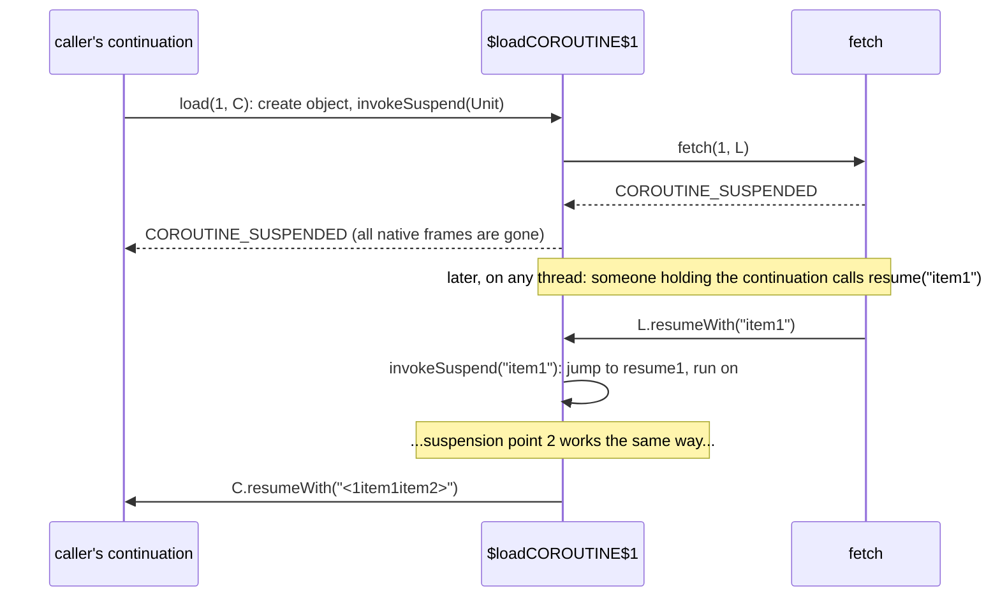

# Coroutines: what a `suspend` function is compiled into

A `suspend` function can stop in the middle, give its thread back, and continue later, possibly on another thread. A native
stack frame cannot do that, so the compiler rewrites every such function: its local state moves into a heap object, and
its body becomes a method that can be entered again at the place where it stopped. The runtime and the GC know nothing about
coroutines. They see ordinary objects and ordinary function calls.

```kotlin
suspend fun fetch(id: Int): String = suspendCoroutine { ... }   // may suspend

suspend fun load(id: Int): String {
    val prefix = "<" + id
    val a = fetch(id)             // suspension point 1
    val b = fetch(id + 1)         // suspension point 2
    return prefix + a + b + ">"
}

suspend fun tail(id: Int): String = fetch(id * 2)
```

After the suspend lowerings (real compiler output, rewritten as Kotlin-like pseudo-code):

```kotlin
fun load(id: Int, `$completion`: Continuation<String>): Any =      // extra parameter: whom to tell the result.
    `$loadCOROUTINE$1`(id, `$completion`)                          // returns a String, or COROUTINE_SUSPENDED
        .invokeSuspend(Result(Unit))                               // allocate the state object, run the first part directly

private class `$loadCOROUTINE$1`(val id: Int, completion: Continuation<String>) : ContinuationImpl(completion) {
    var label: NativePtr                                // where to continue; null = from the start
    var prefix: String                                  // locals that are alive across a suspension point
    var a: String

    override fun invokeSuspend(result: Result<Any?>): Any? {
        if (label != null) goto label                   // not expressible in Kotlin; see the LLVM IR below
        result.exceptionOrNull()?.let { throw it }
        var prefix = "<" + id

        this.prefix = prefix                            // --- suspension point 1: save what is needed later
        this.label = &resume1                           //     remember where to continue
        val r1 = fetch(this.id, this)                   //     `this` is the continuation of the callee
        if (r1 === COROUTINE_SUSPENDED) return r1       //     callee suspended: unwind the native stack normally
        goto after1                                     //     callee finished without suspending: just go on
      resume1:                                          //     entered by a later invokeSuspend(result)
        prefix = this.prefix                            //     restore
        r1 = result.getOrThrow()                        //     the value (or exception) the coroutine was resumed with
      after1:
        var a = r1 as String

        this.a = a; this.prefix = prefix                // --- suspension point 2: the same, now `a` is alive too
        this.label = &resume2
        ...
        return prefix + a + b + ">"                     // `b` never lives across a suspension: it is not a field
    }
}

fun tail(id: Int, `$completion`: Continuation<String>): Any = fetch(id * 2, `$completion`)    // no class at all
```

## Suspending and resuming



While the coroutine is suspended, there is no stack for it. It exists as a chain of heap objects: each state object holds
its saved locals and a reference to the continuation of its caller (`completion`). Whoever will resume it holds a reference
to the innermost object; that reference is all that keeps the coroutine alive.

`resumeWith` is not generated. It is one loop in the base class `BaseContinuationImpl` in the standard library: call
`invokeSuspend`; if it returns `COROUTINE_SUSPENDED`, stop; otherwise pass the result (or the caught exception) to
`completion` and repeat there.

## Jumping into the middle of a function

Kotlin IR has no `goto`, so the lowering leaves two special IR nodes in `invokeSuspend` (`IrSuspendableExpression` around
the body, `IrSuspensionPoint` at each point), and code generation gives them meaning. In LLVM a basic block has an address,
and `indirectbr` jumps to an address held in a value. `label` stores such an address:

```llvm
entry:
  %34 = load ptr, ptr %label_field                               ; this.label
  %35 = icmp eq ptr %34, null
  br i1 %35, label %start, label %dispatch
dispatch:
  indirectbr ptr %34, [label %resume, label %resume3]            ; goto label; the list names all possible targets
...
  store ptr blockaddress(@"kfun:$loadCOROUTINE$1.invokeSuspend#internal", %resume), ptr %label_field    ; label = &resume1
  %48 = call ptr @"kfun:#fetch#suspend(kotlin.Int;kotlin.coroutines.Continuation<kotlin.String>){}kotlin.Any"(
              i32 %47, ptr %0, ptr %9)                           ; fetch(this.id, this)
  %50 = call ptr @"kfun:kotlin.coroutines.intrinsics#<get-COROUTINE_SUSPENDED>(){}kotlin.Any"(ptr %11)
  %51 = icmp eq ptr %48, %50                                     ; suspended? then return %48
  br i1 %51, label %when_case1, label %when_exit2
...
resume:
  %86 = load ptr, ptr %prefix_field                              ; prefix = this.prefix
  %87 = call ptr @"kfun:kotlin#getOrThrow__at__kotlin.Result<0:0>(){0§<kotlin.Any?>}0:0"(ptr %1, ptr %14)
  br label %continuation_block                                   ; joins the path that did not suspend
```

(`%label_field` and `%prefix_field` stand for `getelementptr` instructions that compute the field addresses.)

## Things to know

- **Every suspend function gets a hidden last parameter**, the **continuation** of its caller, and returns `Any?`: either the
  real result or the marker object `COROUTINE_SUSPENDED`. A suspend function can only be called by code that has a
  continuation to pass, which is why ordinary functions cannot call it.
- **No state object if all suspend calls are tail calls.** `tail` above returns whatever `fetch` returns, so it has nothing
  to do after resumption. It only passes its own continuation on. A call inside a `try` is never a tail call.
- **Only variables that are alive across a suspension point become fields.** A
  [liveness analysis](../compiler/lowerings/CoroutinesLivenessAnalysis.md) decides this per suspension point. Fewer
  fields means a smaller object, less copying, and no garbage kept alive by a suspended coroutine. `id` is a field
  because all parameters are; `b` is not, because it is assigned after the last point.
- **The first part runs without any suspension machinery.** `load` calls `invokeSuspend` directly. If nothing suspends, the
  result is returned as a normal return value and the cost was one allocation.
- **Results travel as `Any?`**, so a suspend function returning `Int` returns a boxed `Int`
  ([Autoboxing](../compiler/lowerings/Autoboxing.md)). Exceptions travel inside `Result` on resumption and are rethrown by `getOrThrow`.
- **This repository contains only the mechanism**: the transformation, and the low-level API in `kotlin.coroutines`
  (`Continuation`, `suspendCoroutine`, `startCoroutine`, `ContinuationInterceptor`). Everything people usually associate
  with coroutines (`launch`, `async`, `Job`, dispatchers, cancellation, `Flow`) is the library kotlinx.coroutines, which
  lives in another repository and is built on that API. A dispatcher, for example, is a `ContinuationInterceptor` that
  wraps a continuation so that `resumeWith` schedules the work on a thread pool instead of running it at once.

## Where the code is

- [NativeSuspendFunctionLowering.kt](../../../kotlin-native/backend.native/compiler/ir/backend.native/src/org/jetbrains/kotlin/backend/konan/lower/NativeSuspendFunctionLowering.kt)
  and its shared base [AbstractSuspendFunctionsLowering.kt](../../../compiler/ir/backend.common/src/org/jetbrains/kotlin/backend/common/lower/AbstractSuspendFunctionsLowering.kt):
  build the class and `invokeSuspend`. Lowering pages:
  [NativeSuspendFunctionsLowering](../compiler/lowerings/NativeSuspendFunctionsLowering.md),
  [NativeAddContinuationToFunctionCallsLowering](../compiler/lowerings/NativeAddContinuationToFunctionCallsLowering.md).
- [CoroutinesVarSpillingLowering.kt](../../../kotlin-native/backend.native/compiler/ir/backend.native/src/org/jetbrains/kotlin/backend/konan/lower/CoroutinesVarSpillingLowering.kt):
  the save and restore of live variables ([lowering page](../compiler/lowerings/CoroutinesVarSpillingLowering.md)).
- [IrToBitcode.kt](../../../kotlin-native/backend.native/compiler/ir/backend.native/src/org/jetbrains/kotlin/backend/konan/llvm/IrToBitcode.kt):
  search for `evaluateSuspendableExpression` and `evaluateSuspensionPoint` to find the `indirectbr` dispatch.
- [ContinuationImpl.kt](../../../kotlin-native/runtime/src/main/kotlin/kotlin/coroutines/ContinuationImpl.kt): the base classes
  and the `resumeWith` loop.
- [IntrinsicsNative.kt](../../../kotlin-native/runtime/src/main/kotlin/kotlin/coroutines/intrinsics/IntrinsicsNative.kt): how
  a coroutine is created and started from a suspend lambda or function reference.
