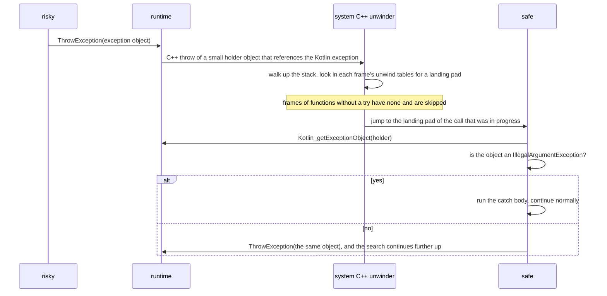

[Kotlin/Native guide](../README.md) › [features](README.md) › exceptions

# Exceptions: how `throw` reaches `catch`

*Skip this page if you know that a Kotlin exception travels as a C++ exception and what a Kotlin landing pad does.*

Kotlin/Native does not have its own mechanism for finding the `catch` that handles a `throw`. It reuses the one every
platform already has for C++: a Kotlin exception is thrown **as a C++ exception** whose only content is a reference to the
Kotlin exception object, and the system's C++ unwinding library carries it up the stack. The compiler only has to mark which
calls are inside a `try`, and to check the exception's type once it arrives.

```kotlin
fun risky(x: Int): Int {
    if (x < 0) throw IllegalArgumentException("negative")
    return x * 2
}

fun safe(x: Int): Int =
    try { risky(x) } catch (e: IllegalArgumentException) { -1 }
```



## The same thing in LLVM IR

The throwing side is three calls: allocate the exception, run its constructor, call `ThrowException`
([llvm-primer.md](../llvm-primer.md#reading-llvm-ir) shows `risky`). This is the catching side, `safe`:

```llvm
define i32 @"kfun:#safe(kotlin.Int){}kotlin.Int"(i32 %0) personality ptr @__gxx_personality_v0 {   ; "unwind me like C++"
entry:
  %4 = invoke i32 @"kfun:#risky(kotlin.Int){}kotlin.Int"(i32 %0)     ; `invoke`, not `call`: this call is inside a try
          to label %call_success unwind label %landingpad

landingpad:
  %lp = landingpad { ptr, i32 } catch ptr null                       ; accept any exception; the type is checked below
  call void @SetCurrentFrame(ptr %2)                                 ; tell the GC which frame is on top again
  %er = extractvalue { ptr, i32 } %lp, 0
  %5 = call ptr @__cxa_begin_catch(ptr %er)                          ; C++ runtime: "this exception is being handled"
  %6 = call ptr @Kotlin_getExceptionObject(ptr %5, ptr %3)           ; take the Kotlin object out of the C++ holder
  call void @__cxa_end_catch()                                       ; the C++ exception is finished; the object lives on
  %8 = call ptr @Kotlin_Any_getTypeInfo(ptr %6)
  %9 = call i1 @IsSubtype(ptr %8, ptr @"kclass:kotlin.IllegalArgumentException")     ; catch (e: IllegalArgumentException)?
  br i1 %9, label %catch, label %catchCheck

catchCheck:                                                          ; no clause matched
  call void @ThrowException(ptr %6)                                  ; throw it again as a new C++ exception
  unreachable

catch:
  ...                                                                ; the catch body; here it produces -1
```

A `try` with several `catch` clauses has one landing pad and a chain of such `IsSubtype` checks, in source order.

`SetCurrentFrame` repairs the [shadow stack](../runtime/README.md#how-the-gc-finds-references): the frames that were
skipped during unwinding never ran their `LeaveFrame`, so the catching function resets the list to its own frame.

## `finally`

Code generation does not know `finally`. [NativeFinallyBlocksLowering](../compiler/lowerings/control-flow.md#nativefinallyblockslowering) copies the
block onto every way out of the `try` beforehand, and the exceptional way out becomes a catch-all that rethrows:

```kotlin
fun cleanup(x: Int): Int {                  fun cleanup(x: Int): Int {
    try {                                       val tmp = try { risky(x) }
        return risky(x)                                   catch (t: Throwable) { println("done"); throw t }
    } finally {                                 println("done")
        println("done")                         return tmp
    }                                       }
}
```

## An exception nobody catches

For an executable, the compiler generates the entry point `Konan_start`, which wraps `main` (real output):

```kotlin
private fun Konan_start(args: Array<String>): Int {
    try { main(); return 0 }
    catch (e: Throwable) {
        processUnhandledException(e)             // call the user's hook, if one was set with setUnhandledExceptionHook
        terminateWithUnhandledException(e)       // print "Uncaught Kotlin exception: ..." with the stack trace, then abort()
    }
}
```

Exceptions that escape elsewhere (for example on a thread that was not started by Kotlin) end in C++ `std::terminate`,
where a handler installed by the runtime does the same two steps.

## Crossing into other languages

A Kotlin exception must not travel through C, Objective-C or Swift frames, so every boundary has a rule (the Objective-C
behaviour below is taken from the sources, not from a compilation):

| Direction | What happens |
|---|---|
| Kotlin function exported to **Objective-C/Swift**, marked `@Throws(E::class)` | The exported method gets an extra `NSError**` parameter (`throws` in Swift). The generated bridge catches the exception; if it is an `E`, it is wrapped into an `NSError` (domain `KotlinException`, the Kotlin object in `userInfo`) and the method returns `NO`/`nil` |
| The same, without `@Throws`, or the exception is not an `E` | The bridge treats it as unhandled: hook, report, terminate. See [export.md](../interop/export.md) |
| Kotlin function exported to **C** (`-p dynamic`/`static`) | Always terminates |
| Kotlin calls **Objective-C**, which throws an `NSException` | Terminates by default. If the library's `.def` file sets `foreignExceptionMode = objc-wrap`, the call site catches it and throws a Kotlin `ForeignException` holding the `NSException`. See [cinterop.md](../interop/cinterop.md) |

## Things to know

- **A frame without `try` runs nothing during unwinding.** Kotlin has no destructors, so such functions use plain `call`
  and have no landing pads. That is why the catching side must repair the GC's frame list itself.
- **The type check is done by Kotlin code, not by the unwinder.** C++ would let the unwinder pick the handler by type. Kotlin
  landing pads catch everything and rethrow what they do not want.
- **The stack trace is captured when the exception object is created**, in the constructor of `Throwable`, not when it is
  thrown. Only the return addresses are stored; they are turned into function names when the trace is first requested.
  Creating an exception therefore always costs a stack walk, and a rethrown exception keeps its original trace.
- **Not throwing is free.** `invoke` adds no instructions to the normal path: the landing pad is found through tables
  in the binary, which only the unwinder reads.

## Where the code is

- [Exceptions.cpp](../../../kotlin-native/runtime/src/main/cpp/Exceptions.cpp): `ThrowException`, the terminate handler,
  processing and reporting of unhandled exceptions.
- [CodeGenerator.kt](../../../kotlin-native/backend.native/compiler/ir/backend.native/src/org/jetbrains/kotlin/backend/konan/llvm/CodeGenerator.kt):
  generation of landing pads, including the ones at the foreign boundary (search for `filteringExceptionHandler`).
- [IrToBitcode.kt](../../../kotlin-native/backend.native/compiler/ir/backend.native/src/org/jetbrains/kotlin/backend/konan/llvm/IrToBitcode.kt):
  how `try`, `catch` and `throw` are translated (search for `CatchScope`).
- [ObjCExportErrors.mm](../../../kotlin-native/runtime/src/main/cpp/ObjCExportErrors.mm): Kotlin exception ↔ `NSError`.
