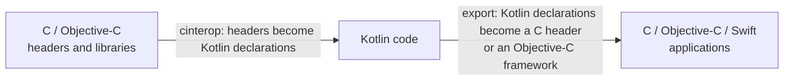

# Interop

*Skip this page if you know that cinterop (Kotlin calls C) and export (C and Swift call Kotlin) are separate mechanisms.*

Kotlin/Native code does not live alone: it calls system libraries written in C and Objective-C, and it is itself packaged
as libraries and frameworks that C, Objective-C and Swift code calls. The two directions are separate mechanisms.

| Page | Direction | What it explains |
|---|---|---|
| [cinterop.md](cinterop.md) | Kotlin calls C and Objective-C | The `cinterop` tool and `.def` files, what a call becomes, platform libraries, the commonizer |
| [export.md](export.md) | C, Objective-C and Swift call Kotlin | The generated C header, Objective-C frameworks, how objects and types cross the boundary |

Related pages elsewhere: what happens to threads and the GC around a foreign call is in [runtime/](../runtime/README.md);
exceptions at the boundary are in [exceptions.md](../features/exceptions.md).
