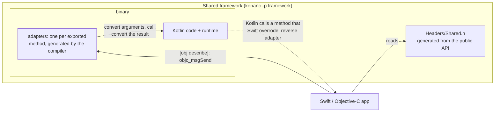

[Kotlin/Native guide](../README.md) › [interop](README.md) › export

# Calling Kotlin from Objective-C, Swift and C (export)

*Skip this page unless you work on a framework or C library produced from Kotlin. Reference material.*

The compiler produces a normal native binary plus a **header** that describes the public Kotlin API in the other language,
and puts an **adapter layer** between the two that converts arguments, results and exceptions. There are two such exports
in the compiler: an Objective-C framework (which is also how Swift sees Kotlin today) and a C library.



## Objective-C: what a Kotlin class looks like

This pair is from the header generator's test data (`native/objcexport-header-generator/testData/headers/simpleDataClass`),
with the `swift_name` attributes removed:

```kotlin
data class SimpleDataClass(val intValue: Int, var intVar: Int, val nullableDefaultStringValue: String? = "")
```
```objc
__attribute__((objc_subclassing_restricted))                        // a final Kotlin class cannot be subclassed
@interface SimpleDataClass : Base                                   // Base is the root of all exported Kotlin classes
- (instancetype)initWithIntValue:(int32_t)intValue intVar:(int32_t)intVar
      nullableDefaultStringValue:(NSString * _Nullable)nullableDefaultStringValue;    // the constructor; no default values
- (SimpleDataClass *)doCopyIntValue:(int32_t)intValue intVar:(int32_t)intVar ...;     // copy() is exported as doCopy     
- (BOOL)isEqual:(id _Nullable)other;                                // equals / hashCode / toString become the
- (NSUInteger)hash;                                                 // NSObject methods with the same meaning
- (NSString *)description;
@property (readonly) int32_t intValue;                              // val
@property int32_t intVar;                                           // var
@property (readonly) NSString * _Nullable nullableDefaultStringValue;
@end
```

In a real framework every class name gets the framework name as a prefix (`SharedSimpleDataClass`, `SharedBase`), because
Objective-C has no packages. Each declaration also carries `__attribute__((swift_name("...")))`, which gives Swift a nicer
name: `init(intValue:intVar:nullableDefaultStringValue:)`.

| Kotlin | Objective-C | Notes |
|---|---|---|
| `class`, `interface` | `@interface`, `@protocol` | |
| `Int`, `Boolean`, `Double` | `int32_t`, `BOOL`, `double` | boxed (`Int?`): `KotlinInt`, an `NSNumber` |
| `String`, `List`, `Map` | `NSString`, `NSArray`, `NSDictionary` | `MutableList` is `NSMutableArray` |
| `(Int) -> String` | a block | |
| top-level `fun` in `Foo.kt` | class method of `FooKt` | |
| `object Foo` | `Foo.shared` | enum entries are class properties too |
| `suspend fun foo()` | `fooWithCompletionHandler:(void (^)(NSError * _Nullable))` | Swift can call it with `await` |
| `@Throws fun foo()` | `fooAndReturnError:(NSError **)` | Swift sees `throws` |

A Kotlin exception that leaves a function without a matching `@Throws` terminates the program.
→ [exceptions.md](../features/exceptions.md#crossing-into-other-languages)

## How objects cross the boundary

Kotlin objects are managed by a tracing garbage collector; Objective-C objects are reference counted. The adapter layer
makes each side see the other side's objects in its own terms:

- **Kotlin object → Objective-C.** The first time a Kotlin object is passed out, the runtime creates an Objective-C *wrapper*
  for it (an instance of the generated class). Later passes return the same wrapper. As long as Objective-C code holds a
  reference to the wrapper, the Kotlin object is a GC root and cannot be collected.
- **Objective-C object → Kotlin.** An object that Kotlin does not know gets a Kotlin wrapper that retains it. When the GC
  collects the wrapper, the retain is released.
- **Strings, collections, numbers and blocks** are not wrapped as Kotlin classes. They are converted to the Foundation type
  from the table.

An Objective-C or Swift class can subclass an open Kotlin class or implement a Kotlin interface. For this the compiler also
generates **reverse adapters**: when Kotlin code calls a virtual method on such an object, the adapter sends the Objective-C
message.

## Swift

Swift imports the framework through the Objective-C header, like any Objective-C framework. That is why Kotlin generics,
enums and top-level functions look less natural in Swift than they could. **Swift export** is a separate, newer project (in
`native/swift`) that generates Swift source code directly. It is still experimental.
→ [docs/swift-export/README.md](../../swift-export/README.md)

## C: a dynamic or static library

`konanc shapes.kt -p dynamic -o shapes` produces `libshapes.so` and `shapes_api.h`. Real output for this file, shortened:

```kotlin
package shapes
class Circle(val r: Double) { fun area(): Double = 3.14 * r * r }
fun describe(c: Circle): String = "circle of radius ${c.r}"
```
```c
typedef struct { shapes_KNativePtr pinned; } shapes_kref_shapes_Circle;    // a handle to a Kotlin object

typedef struct {
  void (*DisposeStablePointer)(shapes_KNativePtr ptr);                     // release a handle
  void (*DisposeString)(const char* string);                               // free a returned string
  ...
  struct { struct { struct {                                               // nesting follows the packages
        struct {
          shapes_kref_shapes_Circle (*Circle)(shapes_KDouble r);           // constructor
          shapes_KDouble (*get_r)(shapes_kref_shapes_Circle thiz);
          shapes_KDouble (*area)(shapes_kref_shapes_Circle thiz);
        } Circle;
        const char* (*describe)(shapes_kref_shapes_Circle c);
  } shapes; } root; } kotlin;
} shapes_ExportedSymbols;
extern shapes_ExportedSymbols* shapes_symbols(void);                       // the only exported function
```

A C client calls `shapes_symbols()->kotlin.root.shapes.Circle.Circle(2.0)`. The API is a table of function pointers and
every object is an opaque handle, which keeps its Kotlin object alive until the client calls `DisposeStablePointer`. Each
returned object is a new handle, and C code cannot implement a Kotlin interface.

## Things to know

- **Exported Objective-C classes are empty in the binary.** Their methods are attached by the runtime the first time a class
  is used, from adapter tables the compiler emits. A missing or wrong method is a run-time problem, not a link error.
- **The header and the adapters are produced separately** and must agree on every name. The header generator is its own
  module and is also used by the IDE.
- **Names are made unique by appending `_`** when two Kotlin declarations would get the same Objective-C name. Which one
  gets the underscore depends on the order of translation, so reordering declarations can change the header.
- **Every call into Kotlin switches the thread to the "runnable" state** and back on return, and initializes the runtime on
  that thread if needed. → [runtime/](../runtime/README.md#threads-and-their-two-states)

## Where the code is

- [native/objcexport-header-generator/](../../../native/objcexport-header-generator/ReadMe.md): Kotlin API → Objective-C header;
  its `testData/headers` has a `.kt` + `.h` pair for every mapping rule
- [ObjCExportCodeGenerator.kt](../../../kotlin-native/backend.native/compiler/ir/backend.native/src/org/jetbrains/kotlin/backend/konan/llvm/objcexport/ObjCExportCodeGenerator.kt):
  generates the adapters
- [ObjCExport.mm](../../../kotlin-native/runtime/src/main/cpp/ObjCExport.mm): the runtime side, with wrappers and conversions
- [cexport/](../../../kotlin-native/backend.native/compiler/ir/backend.native/src/org/jetbrains/kotlin/backend/konan/cexport):
  the C header and its adapters
- [native/swift/](../../../native/swift/README.md): Swift export
