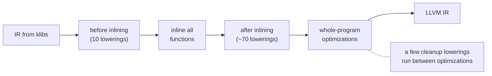

# Lowerings

A **lowering** rewrites Kotlin IR into simpler Kotlin IR. Each one removes a language feature (enums, lambdas, `suspend`,
default arguments, …) by expressing it through plainer constructs. After the last lowering the IR contains only what LLVM code
generation understands: classes with fields, functions, calls, branches, loops and `try`/`catch`.

```kotlin
// what you write                      // what code generation sees (roughly)
enum class Color { RED, BLUE }         class Color : Enum<Color> { static val $VALUES: Array<Color> ... }
val f = { x: Int -> x + 1 }            class main$lambda$0 : Function1<Int, Int> { fun invoke(x: Int) = x + 1 }
fun greet(name: String = "you")        fun greet$default(name: String?, mask: Int) { ... }
```

## When they run

Almost all lowerings run in the second stage (klibs → binary), one file at a time, in a fixed order. The inliner splits them
into two lists:



- **Per file.** A lowering sees one file and may only change that file. Other files may be at a different step.
- **The inliner is the exception.** It copies function bodies across files, so every file is first brought to the same point
  (everything before inlining is done), and only then inlining starts.
- **A few lowerings run in the first stage** (sources → klib), before the IR is written to the klib. Their result is stored in
  the klib, so there are few of them.

To see what a lowering does to your code, dump the IR around it:
`-Xphases-to-dump-before=EnumClassLowering -Xphases-to-dump-after=EnumClassLowering`. The phase name is the class name.

## All lowerings

In the order they run. A linked name has its own page with a before/after example. *Shared* lowerings are common to all
backends and live in [backend.common](../../../compiler/ir/backend.common/src/org/jetbrains/kotlin/backend/common/lower/);
the others are Native-specific and live in
[backend/konan/lower](../../../kotlin-native/backend.native/compiler/ir/backend.native/src/org/jetbrains/kotlin/backend/konan/lower/).
The ordered lists themselves are in
[NativeLoweringPhases.kt](../../../kotlin-native/backend.native/compiler/ir/backend.native/src/org/jetbrains/kotlin/backend/konan/driver/phases/NativeLoweringPhases.kt).

### Before inlining

| Lowering | What it does |
|---|---|
| [TestProcessor](TestProcessor.md) | Collects `@Test` functions into generated test-suite classes (only when building tests) |
| UpgradeCallableReferences *(shared)* | Brings lambdas and `::references` to one uniform IR shape |
| [NativeAssertionWrapperLowering](NativeAssertionWrapperLowering.md) | Wraps `assert(...)` so it can be switched on or off when the binary is built |
| LateinitLowering *(shared)* | Adds the "has it been initialized?" check to `lateinit` reads |
| SharedVariablesLowering *(shared)* | Puts a local `var` that a lambda modifies into a heap box |
| LocalClassesInInlineLambdasLowering *(shared)* | Moves local classes out of inline lambdas so inlining does not duplicate them |
| ArrayConstructorLowering *(shared)* | `Array(n) { i -> ... }` becomes a loop |
| [NativePrivateFunctionInlining](NativeInlining.md) | Inlines private inline functions |
| OuterThisInInlineFunctionsSpecialAccessorLowering *(shared)* | Adds an accessor for the outer `this` used inside an inline function |
| SyntheticAccessorLowering *(shared)* | Adds accessors for private members that an inline function exposes to other files |
| [NativeAllFunctionInlining](NativeInlining.md) | Inlines all remaining inline functions, across files and klibs |
| [SpecialObjCValidationLowering](SpecialObjCValidationLowering.md) | Reports suspend calls inside `autoreleasepool { }` |

### After inlining

| Lowering | What it does |
|---|---|
| ConstEvaluationLowering *(shared)* | Evaluates constant expressions at compile time |
| [ReifiedFunctionLowering](ReifiedFunctionLowering.md) | Replaces the leftover bodies of `reified` inline functions with a throw |
| [TypeOfProcessingLowering](TypeOfProcessingLowering.md) | `typeOf<T>()` becomes a constant `KType` |
| [NativeSharedVariablesPrimitiveBoxSpecializationLowering](NativeSharedVariablesPrimitiveBoxSpecializationLowering.md) | Uses a specialized box for captured `var`s of primitive type |
| [InteropLowering](InteropLowering.md) | Calls to C and Objective-C, and Kotlin subclasses of ObjC classes, become bridges and C stubs |
| [SpecialInteropIntrinsicsLowering](SpecialInteropIntrinsicsLowering.md) | Interop intrinsics that can only be handled after inlining |
| [TestsInitializer, TestsDumper](TestProcessor.md) | Register the generated test suites at startup; write the list of tests to a file |
| ExpectDeclarationsRemoveLowering *(shared)* | Removes `expect` declarations |
| StripTypeAliasDeclarationsLowering *(shared)* | Removes `typealias` declarations |
| [NativeAssertionRemoverLowering](NativeAssertionWrapperLowering.md) | Keeps or removes assertions depending on `-enable-assertions` |
| [VolatileFieldsLowering](VolatileFieldsLowering.md) | `@Volatile` fields and atomic operations on them become atomic intrinsics |
| DelegatedPropertyOptimizationLowering *(shared)* | Simplifies trivial property delegation |
| [PropertyReferenceLowering](PropertyReferenceLowering.md) | `::prop` becomes a `KProperty` object |
| [NativeFunctionReferenceLowering](NativeFunctionReferenceLowering.md) | Lambdas and `::function` references become classes implementing `FunctionN` |
| [NativeSingleAbstractMethodLowering](NativeSingleAbstractMethodLowering.md) | SAM conversion becomes a class implementing the `fun interface` |
| [PostInlineLowering](PostInlineLowering.md) | Folds `typeOf`, `immutableBlobOf` and `::class` left by the inliner into constants and calls |
| [ContractsDslRemover](ContractsDslRemover.md) | Removes `contract { }` blocks |
| [NativeAnnotationImplementationLowering](NativeAnnotationImplementationLowering.md) | Creating an annotation instance becomes creating a generated implementation class |
| RangeContainsLowering *(shared)* | `x in a..b` becomes `a <= x && x <= b` |
| [EnumConstructorsLowering](EnumConstructorsLowering.md) | Adds the `name` and `ordinal` parameters to enum constructors |
| InitializersLowering *(shared)* | Moves property initializers and `init` blocks into constructors |
| [InteropBridgesNameInventor](InteropBridgesNameInventor.md) | Gives interop bridges unique names |
| [NativeInventNamesForLocalClasses, NativeKlibInventNamesForLocalFunctions](NativeLocalDeclarationsLowering.md) | Name anonymous and local declarations |
| LocalDelegatedPropertiesLowering *(shared)* | A local `val x by d` becomes a variable plus `getValue` calls |
| [NativeLocalDeclarationsLowering](NativeLocalDeclarationsLowering.md) | Local functions and classes get their captured variables as explicit parameters and fields |
| LocalDeclarationPopupLowering *(shared)* | Moves those local declarations up to the enclosing class or file |
| [NativeTailrecLowering](NativeTailrecLowering.md) | `tailrec` functions become loops |
| [NativeFinallyBlocksLowering](NativeFinallyBlocksLowering.md) | Copies each `finally` block onto every way out of its `try` |
| [ComputeTypesPass](ComputeTypesPass.md) | Recomputes precise expression types that inlining made too general (runs twice) |
| [NativeForLoopsLowering](NativeForLoopsLowering.md) | `for` over ranges, arrays and similar becomes a counting loop without an iterator |
| FlattenStringConcatenationLowering, StringConcatenationLowering *(shared)* | String templates and `+` become `StringBuilder` appends |
| [StringConcatenationTypeNarrowing](StringConcatenationTypeNarrowing.md) | Calls `toString()` up front so appends take a `String` (`-opt` only) |
| [NativeDefaultArgumentStubGenerator, …Cleaner, …Injector](NativeDefaultArguments.md) | Default arguments: a `foo$default` stub with a bit mask, and callers that pass the mask |
| [InnerClassLowering](InnerClassLowering.md) | An `inner class` gets a field holding the outer instance |
| [DataClassOperatorsLowering](DataClassOperatorsLowering.md) | Resolves the helper calls inside generated `equals`/`hashCode`/`toString` |
| IfNullExpressionsFusionLowering *(shared)* | Simplifies chains of `?.` and `?:` |
| [StaticCallableReferenceOptimization](StaticCallableReferenceOptimization.md) | A function reference that captures nothing becomes a constant object |
| [NativeEnumWhenLowering](NativeEnumWhenLowering.md) | `when` over an enum compares ordinals |
| [EnumClassLowering](EnumClassLowering.md) | An enum class becomes a class with a static array of instances |
| [EnumUsageLowering](EnumUsageLowering.md) | `Color.RED`, `enumValues<T>()` and friends become calls into that class |
| [VarargInjectionLowering](VarargInjectionLowering.md) | `vararg` arguments become an explicitly built array |
| KotlinNothingValueExceptionLowering *(shared)* | Throws if a call declared to return `Nothing` returns anyway |
| [NativeSuspendFunctionsLowering](NativeSuspendFunctionsLowering.md) | A `suspend` function becomes a state-machine class |
| AddContinuationToNonLocalSuspendFunctionsLowering *(shared)* | Adds the hidden `Continuation` parameter to suspend functions |
| [NativeAddContinuationToFunctionCallsLowering](NativeAddContinuationToFunctionCallsLowering.md) | Passes the continuation at every suspend call |
| AddFunctionSupertypeToSuspendFunctionLowering *(shared)* | Makes `SuspendFunctionN` objects also implement `FunctionN+1` |
| [CoroutinesLivenessAnalysis, …Fallback](CoroutinesLivenessAnalysis.md) | Finds which variables are alive at each suspension point |
| ExpressionBodyTransformer *(shared)* | `fun f() = x` becomes `fun f() { return x }` |
| [ObjectClassLowering](ObjectClassLowering.md) | An `object` becomes a static instance field with a getter |
| [StaticInitializersLowering](StaticInitializersLowering.md) | Initializers of globals move into lazy init functions, called on first access |
| [RemoveCastsFromNothingLowering](RemoveCastsFromNothingLowering.md) | Removes casts applied to expressions of type `Nothing` |
| [CastsOptimization](CastsOptimization.md) | Removes casts and type checks that are proven to succeed (runs when generic casts are checked: debug builds by default) |
| [TypeOperatorLowering](TypeOperatorLowering.md) | `as`, `as?`, `is` and implicit casts are reduced to a few basic checks on erased types |
| [BuiltinOperatorLowering](BuiltinOperatorLowering.md) | `==`, `===`, comparisons and similar operators become calls or primitive operations |
| [BridgesBuilding, WorkersBridgesBuilding](BridgesBuilding.md) | Adds bridge functions where an override's machine-level signature differs from the overridden one |
| [ExportCachesAbiVisitor, ImportCachesAbiTransformer](CachesAbiLowering.md) | Accessors for internals that code in another cache needs |
| [GenericCallsReturnTypeEraser](GenericCallsReturnTypeEraser.md) | Calls get the erased return type of the callee, with an explicit cast where needed |
| [Autoboxing](Autoboxing.md) | Inserts explicit box/unbox where a primitive or value class meets `Any` or a generic |
| [ConstructorsLowering](ConstructorsLowering.md) | `Foo(args)` becomes "allocate, then call the constructor as a function" |
| [ReturnsInsertionLowering](ReturnsInsertionLowering.md) | Adds the explicit `return` at the end of `Unit` functions |
| [CastsLowering](CastsLowering.md) | Remaining casts become runtime check calls (without `-opt`; with `-opt` this happens later) |

### Between the whole-program optimizations

| Lowering | What it does |
|---|---|
| PropertyAccessorInlineLowering *(shared)* | Replaces calls to trivial property accessors with field reads (`-opt` only) |
| [InlineClassPropertyAccessorsLowering](InlineClassPropertyAccessorsLowering.md) | Reading the single property of a value class becomes a no-op reinterpretation (`-opt` only) |
| [RedundantCoercionsCleaner](RedundantCoercionsCleaner.md) | Removes `box(unbox(x))` pairs |
| [UnboxInlineLowering](UnboxInlineLowering.md) | Turns trivial unbox calls into field reads |
| [CoroutinesVarSpillingLowering](CoroutinesVarSpillingLowering.md) | Saves live variables into the coroutine object before a suspension and restores them after |

### First stage (stored in the klib)

| Lowering | What it does |
|---|---|
| [NativeExportedBridgeCallDispatchLowering](NativeExportedBridgeCallDispatchLowering.md) | Fixes how Swift-export bridge functions call their targets |
| TestProcessor, UpgradeCallableReferences, NativeAssertionWrapperLowering | Same as above; run here when the corresponding language feature is on |
| Pre-serialization inliner, TailrecCheckerLowering *(shared)* | Inlining inside the module before serialization; `tailrec` validation |
