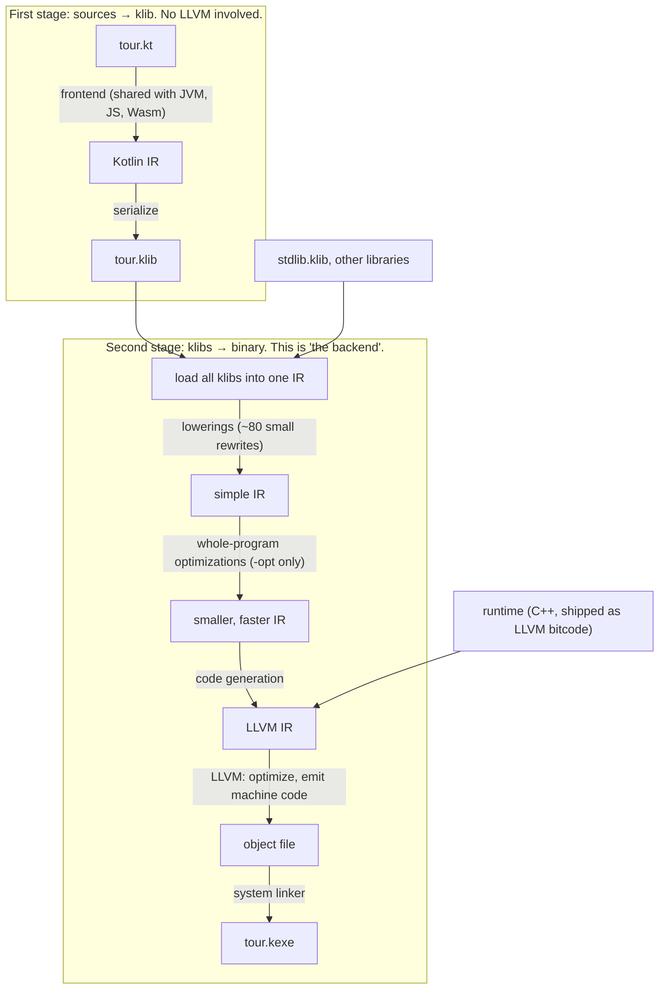

# A tour: from source code to a running binary

This page follows one small program through Kotlin/Native and shows what it looks like at every step. All snippets are real
compiler output, shortened. Each step links to the page that explains it.

```kotlin
// tour.kt
interface Shape { fun area(): Double }
class Circle(val r: Double) : Shape { override fun area() = 3.14 * r * r }
class Square(val side: Double) : Shape { override fun area() = side * side }

fun total(shapes: List<Shape>): Double {
    var sum = 0.0
    shapes.forEach { sum += it.area() }
    return sum
}

fun main() {
    val shapes = listOf(Circle(1.0), Square(2.0))
    println("Total area: ${total(shapes)}")
}
```

## The big picture



Two things make Kotlin/Native different from Kotlin/JVM, and explain most of the design:

- **There is no virtual machine.** Everything a JVM would do at run time (allocation, garbage collection, type checks,
  exceptions, threads) is either compiled into the program or provided by a **runtime** library written in C++ that is linked
  into every binary.
- **The second stage sees the whole program at once**: your code, the standard library and all dependencies. This is called
  a *closed world*. It allows optimizations no separately compiled module could do, such as removing all unused code.

## Step 1. Sources → klib

The frontend is the same one all Kotlin backends use. It checks the program and produces **Kotlin IR**: a tree of classes,
functions and expressions. The first stage then stores that IR in a **klib**, which is a zip archive:

```
default/ir/          the IR of every declaration, including function bodies
default/linkdata/    metadata: declarations as the frontend sees them, for compiling code that uses this library
default/manifest     name, dependencies, versions
default/targets/     for interop libraries: native code for each target
```

A klib contains no machine code and nothing LLVM-specific. It is "half-compiled Kotlin" that is still portable across
targets. → [klibs-and-linking.md](klibs-and-linking.md), [compilation-model.md](compilation-model.md)

## Step 2. All klibs → one IR

The second stage loads the program's klib, `stdlib` and every other dependency, and connects them: a call to `listOf` in
`tour.kt` now points at the actual `listOf` function from the stdlib klib, body included. From here on the compiler works on
one big IR. → [klibs-and-linking.md](klibs-and-linking.md)

## Step 3. Lowerings

About 80 **lowerings** run one after another. Each rewrites one language feature into simpler IR, until only classes,
fields, plain functions, calls, branches and loops are left. → [lowerings/](lowerings/README.md)

Inlining is one of them. `forEach` is an inline function from the stdlib, so its body and our lambda are pasted into `total`:

```kotlin
fun total(shapes: List<Shape>): Double {
    var sum = 0.0
    val iterator = shapes.iterator()
    while (iterator.hasNext()) {
        val element: Any? = iterator.next()             // generics are erased: `next()` returns Any?
        val it = downcast<Shape>(element)               // ...so the cast back to Shape is explicit (checked in debug builds only)
        sum = sum.plus(it.area())
    }
    return sum
}
```

And this is `main` after all lowerings:

```kotlin
fun main() {
    val shapes = listOf(elements = {
        val c = createUninitializedInstance<Circle>()   // `Circle(1.0)` is now: allocate memory...
        c.<init>(r = 1.0)                               // ...then call the constructor as an ordinary function
        val s = createUninitializedInstance<Square>()
        s.<init>(side = 2.0)
        val array = createUninitializedArray<Array<Shape>>(size = 2)    // the vararg became an explicit array
        array.<setWithoutBoundCheck>(0, c)
        array.<setWithoutBoundCheck>(1, s)
        array
    })
    println("Total area: ".plus(<Double-box>(total(shapes))))   // the string template became `plus`; the Double is boxed
    return theUnitInstance()
}
```

## Step 4. Whole-program optimizations (only with `-opt`)

Because the compiler sees the entire program, it can work out facts such as "which classes can this variable actually hold?".
→ [optimizations.md](optimizations.md)

In our program the only lists that can reach `total` come from `listOf(...)`, which returns either an array wrapper (the
stdlib's internal class `asList$1`) or the empty list. So the interface call `shapes.iterator()` is replaced by a check of the
object's class and two direct calls. This is **devirtualization**:

```kotlin
val iterator = when (getObjectTypeInfo(shapes)) {           // was: shapes.iterator(), an interface call
    asList$1::class -> (shapes as asList$1).iterator()      // direct call; LLVM can now inline it
    else -> (shapes as EmptyList).iterator()
}
```

Everything that `main` cannot reach is then deleted. For this program, the number of functions that go on to code generation
drops from 5430 (our code plus the whole stdlib) to 1932.

## Step 5. Kotlin IR → LLVM IR

**LLVM IR** is the input language of LLVM: a typed, low-level language, roughly "portable assembly". If you have not seen it
before, read [llvm-primer.md](llvm-primer.md) first. Code generation translates each Kotlin function into an LLVM function.
→ [codegen.md](codegen.md)

A simple one first. `Circle.area()` takes `this` as a pointer and returns a `double`:

```llvm
define double @"kfun:Circle#area(){}kotlin.Double"(ptr %0) {
  call void @Kotlin_mm_safePointFunctionPrologue()                  ; let the GC pause this thread here if it needs to
  %2 = call double @"kfun:Circle#<get-r>(){}kotlin.Double"(ptr %0)
  %3 = fmul double 3.140000e+00, %2
  %4 = call double @"kfun:Circle#<get-r>(){}kotlin.Double"(ptr %0)
  %5 = fmul double %3, %4
  ret double %5
}
```

`main` shows where the runtime comes in. Everything without the `kfun:` prefix is a C++ function of the runtime:

```llvm
define void @"kfun:#main(){}"() {
  %0 = alloca ptr, i32 8                              ; a block of stack slots for the object references this function holds
  call void @EnterFrame(ptr %0, i32 0, i32 8)         ; register the block, so the GC can find these references
  call void @Kotlin_mm_safePointFunctionPrologue()
  %8 = call ptr @AllocInstance(ptr @"kclass:Circle", ptr %2)        ; ask the runtime for memory for a Circle
  call void @"kfun:Circle#<init>(kotlin.Double){}"(ptr %8, double 1.000000e+00)
  %9 = call ptr @AllocInstance(ptr @"kclass:Square", ptr %3)
  call void @"kfun:Square#<init>(kotlin.Double){}"(ptr %9, double 2.000000e+00)
  %10 = call ptr @AllocArrayInstance(ptr @"kclass:kotlin.Array", i32 2, ptr %4)
  ...
  %12 = call double @"kfun:#total(kotlin.collections.List<Shape>){}kotlin.Double"(ptr %11)
  %13 = call ptr @"kfun:kotlin.Double#toString(){}kotlin.String"(double %12, ptr %6)
  %14 = call ptr @Kotlin_String_plusImpl(ptr @774, ptr %13, ptr %7)  ; @774 is the constant "Total area: "
  call void @"kfun:kotlin.io#println(kotlin.Any?){}"(ptr %14)
  call void @LeaveFrame(ptr %0, i32 0, i32 8)
  ret void
}
```

What to notice:

- **`@"kclass:Circle"`** is a constant describing the class: its size, its supertypes, its table of virtual functions. Every
  object starts with a pointer to such a constant. → [object-model.md](object-model.md)
- **`AllocInstance`** is the runtime's allocator. There is no `new` instruction and no `free`: memory is reclaimed by the
  garbage collector. → [gc-and-allocator.md](gc-and-allocator.md)
- **`EnterFrame` / `LeaveFrame`** and the extra `ptr` argument passed to calls that return an object: this is how the GC
  finds references held in local variables. Each function keeps them in a block of stack slots and tells the runtime where
  the block is. → [runtime.md](runtime.md)
- **Safepoints** are places where a thread checks whether the GC wants it to pause. The compiler puts one at the start of
  every function and in every loop.
- **String literals and class descriptions are constants** in the binary; nothing is built at startup.

## Step 6. LLVM IR → binary

1. **The runtime is added.** The runtime is written in C++ but ships precompiled to LLVM bitcode (`runtime.bc`, plus one
   file per replaceable part, e.g. `concurrent_ms_gc.bc` for the default garbage collector). The compiler merges the chosen
   files into the program's LLVM module. Since runtime and program are now one module, LLVM can inline small runtime
   functions, such as the safepoint check, straight into Kotlin code.
2. **LLVM optimizes** the module and emits machine code into an object file (`tour.kexe.o`).
3. **The system linker** (`ld.lld`, or `ld64` on Apple platforms) links it with system libraries into `tour.kexe`. For this
   program that is 727 KB in debug mode and 551 KB with `-opt`.

→ [codegen.md](codegen.md), [caches.md](caches.md) (how most of this work is skipped for libraries that did not change)

## Step 7. Running

The operating system calls the C `main` of the runtime. It initializes the runtime (memory manager, the current thread), then
calls the compiler-generated function `Konan_start`, which calls our `main` inside a `try`/`catch` that reports uncaught
exceptions. From here on the program runs with no interpreter or JIT involved. The runtime only does work when the program
asks for it (allocation, type checks, exceptions) or in the background (the GC thread). → [runtime.md](runtime.md)

## Try it yourself

```bash
./gradlew :kotlin-native:dist                      # build the compiler into kotlin-native/dist (slow the first time)
kotlin-native/dist/bin/konanc tour.kt -o tour      # both stages in one go; add -opt for an optimized build

# Kotlin IR after a lowering, written as Kotlin-like code into ./ir
konanc -Dorg.jetbrains.kotlin.compiler.ir.dump.strategy=KotlinLike tour.kt -o tour \
    -Xphases-to-dump-after=NativeAllFunctionInlining,CastsLowering -Xdump-directory=ir

# LLVM IR right after code generation, written into ./ll (the directory must exist)
konanc tour.kt -o tour -Xsave-llvm-ir-after=Codegen -Xsave-llvm-ir-directory=ll

# just the klib
konanc tour.kt -p library -o tour && unzip -l tour.klib
```

## Where to go next

- The same pipeline with every step named: [pipeline.md](pipeline.md)
- Where all this lives in the repository: [code-map.md](code-map.md)
- LLVM concepts used above: [llvm-primer.md](llvm-primer.md)
